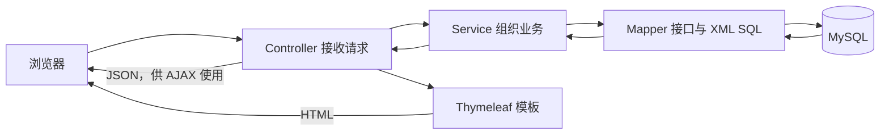

# My Blog — 项目分析与学习文档

> 分析目的：learning（新手学习）
> 重点：项目整体结构、请求流转、核心功能、代码阅读顺序
> 项目路径：`D:\Program\My-Blog-master`
> 最后更新：2026-10-10（Asia/Shanghai）

---

## 分析进度

| 阶段 | 状态 | 备注 |
|---|---|---|
| 1. 项目文档 | ✅ | 已阅读 README、upgrade 与 static-files 说明，结论区分文档描述与待验证实现 |
| 2. 目录结构与技术栈 | ✅ | 已核实目录、依赖版本、入口、分层与 8 个学习模块 |
| 3. Git / PR 历史 | ✅ | 核实 3 个本地提交、无远端；解释主题清理与前台 UI 改造 |
| 4a. 文章阅读与检索 | ✅ | 首页、详情、分页、搜索；先理解读取流程 |
| 4b. 后台文章管理 | ✅ | 列表、编辑、保存、更新、删除与 Markdown |
| 4c. 分类与标签 | ✅ | 内容组织、文章关联与筛选 |
| 4d. 评论 | ✅ | 前台提交与后台管理 |
| 4e. 友链与网站配置 | ✅ | 友情链接、站点信息、公共页面数据 |
| 4f. 管理员登录与资料 | ✅ | 验证码、Session、拦截器、资料修改 |
| 4g. 上传与 Web 基础设施 | ✅ | 文件存储、静态映射、错误页 |
| 4h. 公共工具与测试 | ✅ | 分页、返回结构、转换工具与现有测试 |

完成状态：阶段 0–4 与 8 个模块全部完成，已补总览、新手学习路线、练习建议和本地运行准备。

---

## 总结

**项目做什么：** 为访客提供文章阅读、检索、分类、评论和友链，为管理员提供内容维护、登录、文件上传及网站配置。

**怎么构建：** Maven 单模块 JAR，Spring Boot 2.7.5 + MyBatis Starter 2.2.2 + Thymeleaf + MySQL。Java 编译目标为 1.8；服务器渲染 HTML，浏览器用 JavaScript/AJAX 完成部分提交和列表更新。

**规模：** 57 个主 Java 文件、11 个控制器、54 个带请求映射的方法、7 组 Service 接口/实现、8 组 Mapper 接口/XML、26 个 HTML 模板、8 张业务表。一个方法可能有多个 URL 别名，因此 54 不是独立 URL 数量。现有测试只有 1 个上下文加载方法；本地 Git 有 3 个提交，无远端。

**最值得学的三件事：** 一次请求怎样跨越 Controller、Service、SQL 和页面；一篇文章怎样关联分类与多个标签；事务、Session、模板和 AJAX 各自解决什么问题。详解结合实际文件和行号，位于后面的 4a–4h。

**值得继续验证的地方：** 正文长度校验误用了标签字段、可缺省路径直接 trim、失败字符串与事务回滚的区别、非原子浏览量写回、评论结果码与 Boolean data 的约定。这些是源码阅读发现，不表示已运行复现，也不建议把全部实现当作标准写法照抄。

**本次验证范围：** 阅读源码、模板、SQL、配置和本地历史，并检查当前终端工具；未导入数据库、构建、启动应用或执行功能测试。仅新增本学习文档，保留已有源码及用户的应用配置修改。

## 新手学习路线

第一遍先只跟一条链：**浏览器请求首页 → Java 查文章 → SQL 查数据库 → Java 整理结果 → 模板显示文章**。每到一个方法，都写下“输入、处理、输出”，遇到工具类先了解用途即可。

| 顺序 | 打开哪里 | 这一遍只回答什么问题 |
|---|---|---|
| 1 | [首页入口](D:/Program/My-Blog-master/src/main/java/com/site/blog/my/core/controller/blog/MyBlogController.java:47) | `/` 为什么进入 index？为什么默认是第 1 页？ |
| 2 | [首页业务](D:/Program/My-Blog-master/src/main/java/com/site/blog/my/core/service/impl/BlogServiceImpl.java:192) | 每页 8 条和发布状态条件在哪里设置？返回数据长什么样？ |
| 3 | [Mapper 接口](D:/Program/My-Blog-master/src/main/java/com/site/blog/my/core/dao/BlogMapper.java:24)与[对应 SQL](D:/Program/My-Blog-master/src/main/resources/mapper/BlogMapper.xml:37) | Java 方法怎样对应 SQL？为什么列表和总数要分别查询？ |
| 4 | [首页模板](D:/Program/My-Blog-master/src/main/resources/templates/blog/amaze/index.html:35) | `th:each` 怎样生成多个卡片？模板怎样找到 request 中的数据？ |
| 5 | [编辑提交脚本](D:/Program/My-Blog-master/src/main/resources/static/admin/dist/js/edit.js:141)与[保存方法](D:/Program/My-Blog-master/src/main/java/com/site/blog/my/core/service/impl/BlogServiceImpl.java:41) | 哪段代码在浏览器运行？文章、标签和关联表按什么顺序写入？ |
| 6 | [登录入口](D:/Program/My-Blog-master/src/main/java/com/site/blog/my/core/controller/admin/AdminController.java:54)与[拦截器](D:/Program/My-Blog-master/src/main/java/com/site/blog/my/core/interceptor/AdminLoginInterceptor.java:22) | 登录状态保存在哪里？未登录请求什么时候被拦住？ |

再按 4c–4h 学分类、标签、评论、配置和上传。可以先略过第三方插件源代码、实体 getter/setter 和重复 CRUD，只在调用链需要时回头查。

几个概念要分清：**接口**定义能做什么，框架注入的实现负责执行；Mapper 的实现由 MyBatis 提供，不需要自己写 `BlogMapperImpl`。**Entity**承载存储数据，**VO**整理页面数据。**Session**保留同一浏览器会话的服务器状态。**JSON 业务码**是响应内容，**HTTP 状态码**属于网络响应，两者可能不同。

### 建议练习（本次未修改或执行）

| 练习 | 要观察的结果 |
|---|---|
| 计算分页，不接数据库 | page=2、limit=8 时 start=8；17 条、每页 8 条时总页数为 3。 |
| 在自己的练习分支把首页每页 8 条改成 5 条 | 找到 limit 设置，观察列表和总页数变化；先保持搜索页的 9 条规则。 |
| 对比一篇文章的草稿与发布状态 | 跟踪后台能看到而前台只显示发布文章的 SQL 条件。 |
| 改进正文长度校验和路径缺参处理 | 前后端使用相同字段校验；分别覆盖正常正文、过长正文、空路径和缺省路径。 |
| 跟踪评论状态 | 提交后为 0，审核后为 1；比较数据库状态、前台显示条件和返回结果。 |

---

## 分析约定

- 用中文解释，保留类名、方法名、注解和配置项等技术标识。
- 面向新手，解释每一层负责什么、一次请求经过哪些步骤，以及容易混淆的概念。
- 区分 README 声称的功能与源码已经验证的行为；结论引用实际文件和代码位置。
- 每完成一个阶段或模块更新本文件，保留进度，以便中断后继续学习。
- 用户已于 2026-10-10 明确授权一次完成，后续阶段边界只更新进度与发现，不再等待确认。
- 本次以阅读和解释为主；保留现有源码和配置修改。已知用户修改了 `src/main/resources/application.properties`。

## 已完成的分析路线

1. 阅读项目文档：了解博客的用途、功能和运行说明。
2. 梳理目录结构与技术栈：绘制整体分层，提出适合新手的模块阅读顺序。
3. 阅读 Git 历史：在现有历史可用范围内解释项目演变。
4. 逐模块分析：结合实际请求串联入口、业务逻辑、数据库访问和页面呈现。

---

## 阶段 1：从作者文档认识项目

> 本节保留阶段 1 从本地文档取得的发现，标注“文档描述”的内容来自作者说明；实际构建、结构和业务实现已在后面的技术栈及 4a–4h 章节核实。

### 它解决什么问题，谁会用它

**My Blog 是个人博客项目，也被作者定位为 Spring Boot 技术栈的学习项目。** 你可以用它发布自己的文章，也可以顺着一个完整的博客功能理解页面、Java 代码和数据库如何配合。[README：项目定位](D:/Program/My-Blog-master/README.md:17)

理解它时，先把使用者分成两种：

| 使用者 | 页面和操作（文档描述） | 对新手的解释 |
|---|---|---|
| 访客 | 博客首页、文章浏览、友情链接 | 来阅读内容的人看到的前台。首页展示文章，详情页阅读正文，友情链接指向其他网站。 |
| 管理员 | 登录、后台首页、文章管理、文章编辑、评论管理、系统配置 | 博客主人管理内容的后台。文章编辑负责准备内容；文章管理负责管理已保存的文章。具体发布、删除、审核规则仍需读代码确认。 |

前台页面依据 [README：博客展示页面](D:/Program/My-Blog-master/README.md:123)，后台页面依据 [README：后台管理页面](D:/Program/My-Blog-master/README.md:97)。这里的“前台”和“后台”说的是两组面向不同使用者的界面；不要把它们直接等同于“浏览器里的前端代码”和“服务器里的后端代码”。

作者的课程目录还覆盖分类、标签、搜索、分页、验证码、登录拦截器、文件上传、评论和打包部署等知识点。这能帮助规划学习，但课程标题本身不能证明每项行为已经在当前源码中核实。[README：课程目录](D:/Program/My-Blog-master/README.md:54)

### 作者明确说明的技术选择与约束

- **技术组合（文档描述）：Spring Boot + MyBatis + Thymeleaf。** 文档的教程标题直接列出这三个名字。初步理解：Spring Boot 帮助搭建 Java Web 应用；MyBatis 用于把 Java 的数据库操作与 SQL 联系起来；Thymeleaf 用于把数据填进 HTML 页面。具体依赖版本和使用方式留到阶段 2、阶段 4 核实。[README：开发文档](D:/Program/My-Blog-master/README.md:50)
- **分支与版本（文档描述）：当前分支的 Spring Boot 为 2.7.5。** README 同时列出 2.3.7 和 3.x 分支，提醒我们使用教程时要确认版本。[README：版本与分支](D:/Program/My-Blog-master/README.md:9)
- **前台只保留 amaze 主题。** README 说 `MyBlogController` 的 `THEME` 常量固定为 `amaze`；模板位于 `src/main/resources/templates/blog/amaze/`，主题资源位于 `src/main/resources/static/blog/amaze/`，公共脚本位于 `static/blog/plugins/`。这是后续寻找首页和样式的文档线索，还不是本阶段对控制器的源码验证。[README：主题组织方式](D:/Program/My-Blog-master/README.md:141)
- **网站基础信息可以定制。** 作者说明部署后可修改版权文案、logo、备案记录等。具体配置保存在哪里、如何修改，后续查代码。[README：注意事项](D:/Program/My-Blog-master/README.md:31)

README 没有给出完整的分层架构说明或编码约定。不能仅凭这几个技术名字认定项目采用某种具体分层，也不能认定为前后端分离项目。

### 运行准备：文档已经告诉我们什么

1. **数据库初始化入口是 `static-files/my_blog_db.sql`。** 作者明确标注这个路径，本阶段也确认本地文件存在；尚未读取 SQL 内容、导入数据库或验证初始化结果。[README：数据库文件路径](D:/Program/My-Blog-master/README.md:30)
2. **默认管理员账号是 `admin`，密码是 `123456`。** 这是 README 公布的初始登录信息，不代表当前数据库实际保留了这组账号密码；自己部署使用时应修改默认密码。[README：默认登录信息](D:/Program/My-Blog-master/README.md:32)
3. **作者提供了课程和演示入口，但本地 README 没有逐步启动命令。** 课程包含数据源、文件上传和打包部署等主题；本阶段只读取了本地文档，没有打开外部课程或确认其中操作适合当前版本。[README：课程目录](D:/Program/My-Blog-master/README.md:54)
4. `static-files/README.md` 只说明该目录存放帮助文档与有关文件，没有补充导入或启动步骤。[static-files：目录说明](D:/Program/My-Blog-master/static-files/README.md:1)

后续要从构建和配置文件核实 JDK 要求、数据库连接、启动入口、上传目录和访问地址，再形成能执行的运行教程。当前没有启动成功、数据库连接成功或页面可访问的验证结果。已知用户修改过 `src/main/resources/application.properties`，分析将保留该修改。

### 文档中的不一致与缺口

| 观察 | 证据 | 学习时怎样处理 |
|---|---|---|
| 更新日志写到 Spring Boot 3.0.0，README 却写当前分支 2.7.5，并单列 3.x 分支。 | [upgrade：20221215](D:/Program/My-Blog-master/upgrade.md:3)、[README：分支表](D:/Program/My-Blog-master/README.md:9) | 更新日志不能直接代表当前检出版本。阶段 2 以本地构建文件核实版本，避免混用不同版本教程。 |
| 更新日志包含 MyBatis、jqGrid、验证码、上传和历史 bug 的变更。 | [upgrade：版本与验证码](D:/Program/My-Blog-master/upgrade.md:9)、[upgrade：历史修复](D:/Program/My-Blog-master/upgrade.md:25) | 这里只是历史记录；不是对当前运行行为或安全性的验证。实际 Git 历史留到阶段 3。 |
| README 展示功能截图、课程目录、初始化 SQL 路径，但缺少完整的本地运行步骤。 | [README：注意事项](D:/Program/My-Blog-master/README.md:28)、[README：开发文档](D:/Program/My-Blog-master/README.md:48) | 下一阶段先确认环境和配置，再写具体命令；此时不猜测 JDK、MySQL 版本或访问 URL。 |
| 本次可见的项目级 Markdown 以 README 和升级记录为主；未找到项目级架构文档、贡献指南。 | 本地文档清单；第三方静态插件自带文档未作为项目架构说明阅读。 | 后续结合目录与源码还原职责和流程，并标注推断依据。 |

### 新手可以先建立的概念与阅读起点

先跟着一个小功能学：**访客打开首页，为什么会看到文章列表？** 后续可以依次寻找接收首页请求的代码、获取文章的逻辑、查询数据库的代码、显示文章的页面模板。每次只回答“这里接收什么、做什么、把结果交给谁”。这是建议的学习顺序，具体文件和调用链将在后续分析中确认。

再学习文章详情与搜索，最后学习需要登录的后台文章编辑。这样可以先理解内容如何被读取，再理解内容如何被写入和管理。分类是给文章分组，标签是给文章附上关键词，分页是把大量文章分批显示；它们的实际规则仍待读代码。

**本阶段结论：** 已从作者文档确认项目的学习定位、前台/后台功能范围、主题限制和初始化线索。目录分层、依赖版本、请求流程、数据库结构与运行准备的后续分析见下文。

---
## 技术栈

### 已从本地构建文件核实的版本

这是一个 **Maven 单模块 Java Web 项目**：根目录只有一个项目级 `pom.xml`，产物是 `my-blog` JAR，项目版本为 `4.0.0-SNAPSHOT`。[构建信息](D:/Program/My-Blog-master/pom.xml:10)

| 类别 | 本项目实际声明 | 新手可以怎样理解 |
|---|---|---|
| Java | `java.version=1.8`，源码与报告编码 UTF-8 | Maven 声明的编译目标；不等于已确认你电脑实际安装或运行的 JDK 版本。 |
| Web 框架 | Spring Boot **2.7.5**；`spring-boot-starter-web` | 接收 HTTP 请求、组织 Java 对象和配置。当前源码版本以 POM 为准，解决了阶段 1 的文档版本疑问。 |
| 页面模板 | `spring-boot-starter-thymeleaf` | 在服务器端把 Java 数据填进 HTML，再交给浏览器显示。 |
| 数据访问 | MyBatis Spring Boot Starter **2.2.2** | Java Mapper 接口描述可执行哪些查询，对应 XML 写具体 SQL。 |
| 数据库 | MySQL JDBC 驱动，`runtime` 作用域；Hikari 连接池配置 | Java 通过驱动连接 MySQL；连接池复用数据库连接。未核实运行中的 MySQL 服务版本。 |
| 验证码 | Hutool Captcha **5.8.7** | 登录验证码的工具库。 |
| 正文处理 | CommonMark 核心和 GFM 表格扩展，均为 **0.17.0** | 把 Markdown 文章内容转换为 HTML，表格扩展补充表格语法。 |
| 会话相关 | `spring-session-core` | POM 中存在会话相关依赖；实际登录代码读写 `HttpSession`，没有发现 Redis 会话配置。 |
| 测试 | `spring-boot-starter-test`，已有 JUnit Jupiter `@Test` | 现有测试文件只有 `contextLoads()`，用于加载 Spring 上下文；尚不能代表文章或登录功能已被测试覆盖。 |
| 打包 | `spring-boot-maven-plugin` | 提供 Spring Boot 构建和运行支持。项目根目录没有 Maven Wrapper。 |

版本依据分别见 [Java 与 Boot](D:/Program/My-Blog-master/pom.xml:18)、[MyBatis 与工具依赖](D:/Program/My-Blog-master/pom.xml:44)、[测试与打包插件](D:/Program/My-Blog-master/pom.xml:72)；没有单独写版本的 Starter 与驱动应由 Maven 的依赖管理解析，本次未执行依赖解析，不猜具体传递依赖版本。[现有测试](D:/Program/My-Blog-master/src/test/java/com/site/blog/my/core/MyBlogApplicationTests.java:6)

浏览器端是 **HTML + CSS + JavaScript**。后台页面引用 jQuery、Bootstrap、AdminLTE、jqGrid、SweetAlert；编辑页使用 Editor.md 等插件。这些资源直接放在 `static/` 中，[后台脚本引用](D:/Program/My-Blog-master/src/main/resources/templates/admin/blog.html:63)、[编辑页脚本引用](D:/Program/My-Blog-master/src/main/resources/templates/admin/edit.html:151)能看到加载方式。前台公共布局引用 `main.css` 和 `main.js`，详情页另引入代码高亮、评论脚本。[前台布局](D:/Program/My-Blog-master/src/main/resources/templates/blog/amaze/layout.html:11)、[详情页脚本](D:/Program/My-Blog-master/src/main/resources/templates/blog/amaze/detail.html:107)

找到的两个 `package.json` 属于 **第三方插件自带文件**：Editor.md 声明 1.5.0，内部 CodeMirror 声明 5.0.0。它们不是项目级前端构建入口，不能由此得出“先执行 npm install”或“有独立前端工程”。本次文件清单未发现项目级 Vite、Webpack、TypeScript、Docker、Compose 或 CI 工作流配置；`.github/` 当前包含 Issue 模板。

### 启动入口与配置地图

- **Java 程序入口**：[MyBlogApplication.main](D:/Program/My-Blog-master/src/main/java/com/site/blog/my/core/MyBlogApplication.java:16) 调用 `SpringApplication.run(...)`。`@SpringBootApplication` 声明应用入口，`@MapperScan("com.site.blog.my.core.dao")` 注册 DAO 包里的 Mapper 接口。入口 Java 包是 `com.site.blog.my.core`，其子包承载应用各层。
- **应用配置**：[application.properties](D:/Program/My-Blog-master/src/main/resources/application.properties:1) 设置端口 `8080`、Thymeleaf 缓存关闭；数据库地址为 `localhost:3306`，库名 `my_blog_db`。连接池最少空闲连接 5、最大连接 15。数据库密码不写入学习文档，用户现有配置修改保留。
- **SQL 文件位置**：[MyBatis 配置](D:/Program/My-Blog-master/src/main/resources/application.properties:20) 指向 `classpath:mapper/*Mapper.xml`，同时打开下划线到驼峰转换。例如数据库的 `blog_title` 对应 Java 的 `blogTitle`；XML 也显式写有字段映射。
- **上传资源配置**：[Constants](D:/Program/My-Blog-master/src/main/java/com/site/blog/my/core/config/Constants.java:7) 的文件目录为 `/opt/deploy/upload/`，[WebMvc 配置](D:/Program/My-Blog-master/src/main/java/com/site/blog/my/core/config/MyBlogWebMvcConfigurer.java:21) 把 `/upload/**` URL 映射到该目录。这个默认路径带有 Linux 部署习惯，后续在 Windows 本地运行前要选择实际可用的保存目录。

从这些入口可安排后续运行步骤：准备符合构建目标的 JDK 与 Maven → 初始化 MySQL → 检查连接和上传目录 → 运行入口或打包 JAR。按当前端口和路由，预期首页为 `http://localhost:8080/`，管理员登录页为 `http://localhost:8080/admin/login`；这些是配置推导出的地址，本阶段没有启动应用。

---

## 架构概览

### 一张目录地图

下面省略 `.git/`、`.idea/`、`target/` 和第三方插件内部文件，集中看本项目代码：

```text
My-Blog-master/
├─ pom.xml                        Maven 依赖与打包配置
├─ README.md、upgrade.md           项目说明与升级记录
├─ static-files/                  SQL 初始化脚本、说明与截图
├─ .github/ISSUE_TEMPLATE/         Issue 模板
└─ src/
   ├─ main/
   │  ├─ java/com/site/blog/my/core/
   │  │  ├─ MyBlogApplication.java 启动入口
   │  │  ├─ controller/           admin、blog、common；vo 展示数据对象
   │  │  ├─ service/              业务接口，impl/ 是对应实现
   │  │  ├─ dao/                  MyBatis Mapper 接口
   │  │  ├─ entity/               数据实体与统计对象
   │  │  ├─ config/、interceptor/  Web 配置与登录拦截
   │  │  └─ util/                 分页、返回结构与转换工具
   │  └─ resources/
   │     ├─ application.properties
   │     ├─ mapper/               SQL 映射 XML
   │     ├─ templates/            admin/、blog/amaze/、error/
   │     └─ static/               admin/dist/、admin/plugins/
   │                              blog/amaze/、blog/plugins/
   └─ test/java/.../MyBlogApplicationTests.java
```

规模核对：主源码 **57 个 Java 文件**，包括 11 个控制器（后台 8、前台 1、公共 2）、3 个 VO、7 个 Service 接口及 7 个实现、8 个 Mapper 接口、9 个 entity 包对象、2 个配置类、1 个拦截器、8 个工具类和 1 个入口。资源包含 **8 个 Mapper XML、26 个 HTML 模板**；测试目录有 **1 个 Java 测试文件**。`entity` 的 9 个对象不意味着数据库有 9 张业务表，其中 `BlogTagCount` 用于统计结果。

### 分层分别解决什么问题

**这是一个单体、服务端模板渲染为主并结合 AJAX 的应用。** 前台和管理后台共用一个 Java 进程、一个构建产物及数据库，按控制器和页面目录区分用途。后台先由服务器返回页面，再通过 JavaScript 向相同应用请求 JSON 数据；例如 [blog.js](D:/Program/My-Blog-master/src/main/resources/static/admin/dist/js/blog.js:3) 请求 `/admin/blogs/list`，对应 [BlogController.list](D:/Program/My-Blog-master/src/main/java/com/site/blog/my/core/controller/admin/BlogController.java:45) 上的 `@ResponseBody`。AJAX 指浏览器在页面加载后继续发请求，以更新局部内容或提交操作。

| 层或概念 | 这里负责什么 | 阅读位置 |
|---|---|---|
| Controller 控制器 | 把 URL 和 HTTP 参数交给业务层；返回模板名称或 JSON 数据 | `controller/blog/MyBlogController`、`controller/admin/BlogController` |
| Service 接口 | 声明“业务能做什么”，例如获取首页文章 | `service/BlogService` |
| ServiceImpl 实现 | 决定查询条件、组合多个 DAO、整理结果；保存和更新有事务注解 | `service/impl/BlogServiceImpl` |
| DAO / Mapper | 声明数据库操作方法；由 MyBatis 创建实现对象 | `dao/BlogMapper` |
| Mapper XML | 写 SQL、参数和数据库字段到 Java 属性的对应关系 | `resources/mapper/BlogMapper.xml` |
| Entity 实体 | 承载数据库相关数据，如文章标题、正文、状态 | `entity/Blog`；通常与表结构接近 |
| VO 展示对象 | 为页面组织所需字段，列表、详情可以使用不同结构 | `controller/vo/BlogListVO`、`BlogDetailVO` |
| Template 模板 | 用 `th:each`、`th:text` 等把数据变成网页；片段复用布局 | `templates/blog/amaze/index.html`、`fragments/` |
| Static 静态资源 | 浏览器直接加载的样式、脚本、图片和插件 | `static/blog/amaze/`、`static/admin/` |
| Config / Interceptor | 注册资源映射与登录检查等跨页面规则 | `MyBlogWebMvcConfigurer`、`AdminLoginInterceptor` |

初学时可以把 Controller 看作接待窗口，Service 看作处理业务的人，Mapper 看作取存数据的通道，模板看作展示结果的格式。**Interface 不是又运行一次业务**：Controller 调用 `BlogService` 接口，实际执行的是 Spring 注入的 `BlogServiceImpl`。这里 `@Resource`、`@Autowired` 体现依赖注入，即由框架提供依赖对象。[控制器依赖](D:/Program/My-Blog-master/src/main/java/com/site/blog/my/core/controller/blog/MyBlogController.java:29)、[业务实现与 DAO 依赖](D:/Program/My-Blog-master/src/main/java/com/site/blog/my/core/service/impl/BlogServiceImpl.java:26)

主要调用方向是 Controller → Service → Mapper → SQL → 数据库；数据向上返回到模板或 JSON。代码包的依赖并非完全单向：`BlogService` 与 `BlogServiceImpl` 引用了 `controller.vo` 展示对象，业务层还共享 `entity` 和 `util`。因此应先按实际职责理解，不能仅凭文件夹名字就认为它是严格隔离的多模块架构。[实际引用](D:/Program/My-Blog-master/src/main/java/com/site/blog/my/core/service/impl/BlogServiceImpl.java:3)



模板和静态资源要分清：浏览器收到的是模板被渲染后的 HTML；`static` 中的 JavaScript 在浏览器运行。MyBatis XML 则是服务器执行数据库操作的依据。

### 先跟一次首页请求

1. 访问 `/`，进入 [MyBlogController.index](D:/Program/My-Blog-master/src/main/java/com/site/blog/my/core/controller/blog/MyBlogController.java:47)，它调用 `page(request, 1)`，也就是首页取第 1 页。
2. [page 方法](D:/Program/My-Blog-master/src/main/java/com/site/blog/my/core/controller/blog/MyBlogController.java:58) 调用 `blogService.getBlogsForIndexPage(pageNum)`；[实现方法](D:/Program/My-Blog-master/src/main/java/com/site/blog/my/core/service/impl/BlogServiceImpl.java:192) 设置每页 8 条、发布状态条件，再调用 Mapper 查询列表与总数并生成 `PageResult`。
3. [BlogMapper.findBlogList](D:/Program/My-Blog-master/src/main/java/com/site/blog/my/core/dao/BlogMapper.java:24) 对应 [XML 中的查询](D:/Program/My-Blog-master/src/main/resources/mapper/BlogMapper.xml:37)：从 `tb_blog` 取记录，应用未删除、状态和分页条件。Java 方法本身没有 SQL 正文，SQL 在 XML 中。
4. 控制器把 `blogPageResult`、新文章、热门文章、热门标签及配置放入请求属性，返回视图名 `blog/amaze/index`。[填充模板数据](D:/Program/My-Blog-master/src/main/java/com/site/blog/my/core/controller/blog/MyBlogController.java:63)
5. [index.html 的循环](D:/Program/My-Blog-master/src/main/resources/templates/blog/amaze/index.html:35) 遍历 `blogPageResult.list`，用 `fragments/post-card` 显示各篇文章，并复用分页、侧栏与公共布局。服务器渲染完成后，浏览器看到文章卡片。

现在只需掌握这条结构链；详情数据如何转换、排序规则、页码边界和异常处理，留到模块分析逐行解释。

### 数据库与页面的组织

初始化脚本 [static-files/my_blog_db.sql](D:/Program/My-Blog-master/static-files/my_blog_db.sql:8) 建立 `my_blog_db`。其中有 **11 条 CREATE TABLE**：8 张业务表为 `tb_admin_user`、`tb_blog`、`tb_blog_category`、`tb_blog_comment`、`tb_blog_tag`、`tb_blog_tag_relation`、`tb_config`、`tb_link`；另有 `generator_test`、`jdbc_test`、`tb_test` 三张辅助表。8 个 Mapper XML 对应上述 8 张业务表；脚本中的辅助表不能直接当作博客核心模块。

前台 `templates/blog/amaze/` 包含首页、详情、列表、分类、友链和布局；`fragments/` 拆出文章卡片、侧栏和分页。其样式、脚本、图片在 `static/blog/amaze/`，评论、高亮等资源在 `static/blog/plugins/`。后台 HTML 在 `templates/admin/`，业务脚本集中在 `static/admin/dist/js/`，例如 `blog.js`、`edit.js`、`category.js`、`comment.js`；插件在 `static/admin/plugins/`。后续优先读本项目控制器、模板和业务脚本，第三方插件只在必要时查看。

### 建议的模块学习顺序

下表是 **8 个逻辑学习模块**，不是 Maven 子模块；一个 Java 类可能参与多个模块。例如 `BlogServiceImpl` 同时负责文章读取和文章写入，前台控制器也承载分类、评论和友链入口。

| 顺序 | 模块 | 源码起点与要学的问题 |
|---|---|---|
| 4a | 文章阅读与检索 | `MyBlogController` → `BlogService`/`BlogServiceImpl` → `BlogMapper.xml` → `blog/amaze/`：首页、详情、分页、搜索怎样串起来？ |
| 4b | 后台文章管理 | `BlogController`、`admin/blog.html`、`admin/edit.html`、`blog.js`/`edit.js`：浏览器提交文章后怎样保存、更新和删除？ |
| 4c | 分类与标签 | `CategoryController`、`TagController`、对应 Service/Mapper、`BlogTagRelation`：分类与标签怎样关联文章并参与筛选？ |
| 4d | 评论 | `MyBlogController` 的评论入口、`CommentController`、`CommentService`、评论脚本：提交、展示和后台管理怎样衔接？ |
| 4e | 友链与网站配置 | `LinkController`、`ConfigurationController`、`LinkService`、`ConfigService`：链接与站点信息怎样进入页面？ |
| 4f | 管理员登录与资料 | `AdminController`、`AdminUserService`、`CommonController`、`AdminLoginInterceptor`：验证码与 Session 怎样配合登录检查？ |
| 4g | 上传与 Web 基础设施 | `UploadController`、文章编辑上传入口、`Constants`、`MyBlogWebMvcConfigurer`、`ErrorPageController`：文件怎样保存和访问，错误怎样显示？ |
| 4h | 公共工具与测试 | `PageQueryUtil`、`PageResult`、`Result`/`ResultGenerator`、其他工具及 `MyBlogApplicationTests`：公共结构怎样减少重复，现有测试做了什么？ |

**此刻推荐的阅读动作**：打开首页控制器第 47 行，依次跳到 `getBlogsForIndexPage`、`findBlogList`、`index.html` 第 35 行，只对照每一步的输入和输出。先跑通这个理解过程，再扩展到后台写入，不需要先背完所有注解和工具类。

结构与技术栈已核实，Git 历史和 8 个模块的完整分析见下文。

---

## PR / 提交演变

### 可用历史与证据边界

本地 `main` 仅有 3 个提交，时间集中在 **2026-10-07—2026-10-08**；`git remote -v` 没有输出，因此未配置远端，本次没有查询 PR。以下描述的是当前副本的演变，不能代表 README 所链接原仓库的完整开发史。`upgrade.md` 记录作者历年的升级与修复，但那些记录不是这 3 个本地提交的证据；当前依赖版本仍以 `pom.xml` 为准。

### 阶段 1：导入基线（2026-10-07）

- `e4794bd`，提交标题“原本”。这是本地可见的初始快照。只凭标题无法还原此前如何开发、为何选择这些依赖或解决过哪些问题，不推测作者动机。

### 阶段 2：统一为 amaze 主题（2026-10-07）

- `b302749`，标题“只留下amaze一个主题”，**71 个文件变动，增加 54 行、删除 7,028 行**。主要删除 `default`、`yummy-jekyll` 的模板、静态资源和截图，同步 README 的主题说明。
- `MyBlogController` 把可修改的 `public static String theme` 改为 `private static final String THEME = "amaze"`，返回视图均使用该常量；同时补充 amaze 分类页，并把原来指向 default 的 jQuery 引用改到公共插件目录。这说明主题清理也修正了保留主题对被删除目录的依赖。[当前主题常量](D:/Program/My-Blog-master/src/main/java/com/site/blog/my/core/controller/blog/MyBlogController.java:28)、[README 主题说明](D:/Program/My-Blog-master/README.md:141)

**可确认的决定：** 当前前台固定使用一个主题。修改外观从 amaze 模板和资源入手；这里未发生数据库结构或 Service 业务逻辑迁移。

### 阶段 3：重组前台 UI（2026-10-08）

- `c2d6881`，标题“ui重构”，**123 个文件变动，增加 827 行、删除 15,260 行**。范围集中在前台资源和模板，包含大量旧样式、图片、插件文档及备用高亮样式删除；这些删除行数不能当成业务复杂度减少的度量。
- 新增 `layout.html` 和文章卡片、分页、侧栏片段，页面开始复用公共布局；CSS 由 `main.css` 按 tokens、base、layout、components、pages 顺序导入。[样式入口](D:/Program/My-Blog-master/src/main/resources/static/blog/amaze/css/main.css:1)、[公共布局](D:/Program/My-Blog-master/src/main/resources/templates/blog/amaze/layout.html:3)
- 新增公共 `main.js` 处理菜单、编码后的搜索跳转、回到顶部、验证码刷新和代码高亮。详情页重排正文和评论区域，但保留评论脚本读取的元素 ID。[公共交互](D:/Program/My-Blog-master/src/main/resources/static/blog/amaze/js/main.js:1)、[评论表单约定](D:/Program/My-Blog-master/src/main/resources/templates/blog/amaze/detail.html:62)

**可确认的决定：** 前台布局与交互集中复用。该提交没有改 Java、Mapper SQL、POM 或管理后台，故应理解为前台呈现层改造；不能据此声称后端已升级、性能提高或功能测试通过。

### 对新手学习的意义

本地演变链是“导入基线 → 删除两套主题 → 重组保留主题的 UI”。旧教程中的 `header.html`、`footer.html` 或其他主题路径可能已不存在，应跟随当前文件。历史能解释目录为什么变少、页面为什么使用片段，但两个简短提交未提供详细设计理由，也不足以归纳长期团队习惯。证据来自 `git log -3`、上述两次 `git show --stat` 及精选差异；本阶段只读分析，没有运行页面或测试。

---

## 模块分析

### 4a. 文章阅读与检索

**职责与设计：** 让访客按首页、分类、标签或关键词找到已发布文章，再查看正文。这是逻辑学习模块，共用 `MyBlogController`，没有独立工程。设计效果是“列表只取展示字段，详情才取正文”，以 3 种 VO 分别承载列表、侧栏和详情；代码未记录选择理由，不能把效果当成作者原始动机。[BlogMapper.xml](D:/Program/My-Blog-master/src/main/resources/mapper/BlogMapper.xml:29)、[BlogListVO](D:/Program/My-Blog-master/src/main/java/com/site/blog/my/core/controller/vo/BlogListVO.java:8)

**一次首页请求：** `/`、`/index`、`/index.html` → `index()` → `page(...,1)` → `getBlogsForIndexPage()` 设置 `limit=8`、`blogStatus=1` → Mapper 查询文章与总数 → `getBlogListVOsByBlogs()` 批量查分类图标 → `PageResult` → `index.html` 循环展示卡片。`start=(page-1)*limit`，所以第 2 页跳过前 8 条；总页数向上取整。首页和“最新发布”按文章 ID 倒序，“点击最多”按浏览量倒序；两个侧栏各最多 9 条。[首页入口](D:/Program/My-Blog-master/src/main/java/com/site/blog/my/core/controller/blog/MyBlogController.java:47)、[业务实现](D:/Program/My-Blog-master/src/main/java/com/site/blog/my/core/service/impl/BlogServiceImpl.java:192)、[页面循环](D:/Program/My-Blog-master/src/main/resources/templates/blog/amaze/index.html:34)

**接口与分支（均为 GET）：**

| 输入路径 | 业务处理与输出 |
|---|---|
| `/page/{pageNum}` | 首页分页，8 条/页；`/` 默认第 1 页。 |
| `/blog/{blogId}`、`/article/{blogId}` | ID 详情；`commentPage` 默认 1，另查询评论页。 |
| `/tag/{tagName}`、`/tag/{tagName}/{page}` | 先找标签，再通过关联表找文章，9 条/页。 |
| `/category/{categoryName}`及追加 `/{page}` | 先找分类，再按分类 ID 查询，9 条/页；缺少“默认分类”记录时使用 ID 0。 |
| `/search/{keyword}`及追加 `/{page}` | 对标题或分类名做 `LIKE` 匹配，9 条/页；不搜索正文。 |
| `/categories` | 分类导航及热门标签，输出 `category.html`。 |
| `/{subUrl}` | 单段自定义路径（如 `/about`），按 `blog_sub_url` 查详情。 |

分类、标签、搜索默认第 1 页，共用 `list.html`，由 `pageUrl`、`keyword` 区分。浏览器搜索先去首尾空格、`encodeURIComponent` 后跳转，但后端只接受中英文和数字，含空格、`+` 等仍不能检索。[检索入口](D:/Program/My-Blog-master/src/main/java/com/site/blog/my/core/controller/blog/MyBlogController.java:108)、[分支实现](D:/Program/My-Blog-master/src/main/java/com/site/blog/my/core/service/impl/BlogServiceImpl.java:232)、[关键词规则](D:/Program/My-Blog-master/src/main/java/com/site/blog/my/core/util/PatternUtil.java:28)、[搜索脚本](D:/Program/My-Blog-master/src/main/resources/static/blog/amaze/js/main.js:12)

**关键技术与副作用：** 列表 SQL 同时过滤 `is_deleted=0` 和发布状态；详情 SQL 先过滤软删除，再由 Service 判断 `blogStatus==1`。详情读取后先将浏览量读出加 1 并写回，再用 CommonMark（含表格扩展）把 Markdown 转成 HTML；数据库正文不因此改为 HTML。详情 VO 把逗号标签拆成列表、补分类图标及已审核评论数，模板 `th:utext` 展示正文，脚本进行代码高亮。**读文章也会写数据库**，刷新或翻评论页都会再次计数。[查询条件](D:/Program/My-Blog-master/src/main/resources/mapper/BlogMapper.xml:37)、[详情转换](D:/Program/My-Blog-master/src/main/java/com/site/blog/my/core/service/impl/BlogServiceImpl.java:311)、[正文显示](D:/Program/My-Blog-master/src/main/resources/templates/blog/amaze/detail.html:31)

**依赖关系：** 前台页面依赖 BlogService；实现依赖 Blog、分类、标签和评论 Mapper，使用分页、BeanUtils、Markdown 工具；控制器另外调用配置、标签、分类和评论服务。`Blog` 保留存储字段（正文、状态、删除标记等），VO 只给页面所需数据，避免模板直接承担查询和转换逻辑。

**边界与局限：** 无匹配文章或超出总页数时展示空态，不自动退回最后一页；分页条仅在总页数大于 1 时显示。标签/分类不存在、关键词非法、这些分支页码≤0 返回 `null`，仍由列表模板展示“没有找到相关文章”；首页没有同样的正页码校验。ID 详情缺失仍返回详情模板的“文章不存在”，自定义路径缺失返回 `error/error_400` 视图，视图名不能证明 HTTP 状态为 400；自定义路径详情也未加载评论分页。浏览量采用读后写回且更新多个字段，非数据库原子自增，并发访问存在覆盖计数/字段的可能；未作运行验证。现有测试仅 `contextLoads()`，没有上述流程的专门用例。学习时先画出每一步输入输出，再比较列表与详情为什么需要不同字段。[空态](D:/Program/My-Blog-master/src/main/resources/templates/blog/amaze/detail.html:95)、[自定义路径](D:/Program/My-Blog-master/src/main/java/com/site/blog/my/core/controller/blog/MyBlogController.java:270)、[写回 SQL](D:/Program/My-Blog-master/src/main/resources/mapper/BlogMapper.xml:292)

### 4b. 后台文章管理

**职责与设计：** 管理员读取包含草稿的文章列表、编辑 Markdown、保存或更新文章、批量删除。前端负责编辑体验与 AJAX，Controller 接参数和校验，Service 编排文章、分类、标签与关联表。这种拆分把“页面怎样操作”和“数据怎样一起保存”分开；源码未给出替代方案的选择理由。[BlogController](D:/Program/My-Blog-master/src/main/java/com/site/blog/my/core/controller/admin/BlogController.java:45)

**接口与数量：** 除图片上传（见 4g），这里有 7 个处理方法：GET `/admin/blogs` 返回列表模板，GET `/blogs/list`（均在 `/admin` 下）返回 `Result.data=PageResult`，GET `/blogs/edit` 返回新增页，GET `/blogs/edit/{blogId}` 回填未删除文章与分类；POST `/blogs/save`、`/blogs/update` 接表单参数，POST `/blogs/delete` 接 JSON 整数 ID 数组。后台 jqGrid 默认每页 10 条，可选 20/50；列表 SQL 过滤删除标记，通常不限定发布状态，因此显示草稿和发布文章；搜索按标题或分类名匹配，浏览器限制关键词 20 字符。[列表脚本](D:/Program/My-Blog-master/src/main/resources/static/admin/dist/js/blog.js:3)

**一条保存链：** `edit.html` 用隐藏 `blogId=0` 区分新增；编辑已有文章时 Thymeleaf 回填标题、逗号标签、分类、封面和正文。Editor.md 的 `getMarkdown()` 取原文，点击“保存文章”先打开封面/状态弹窗，再由 `saveButton` 组装字段；`blogId>0` 切换更新地址。Controller 创建 `Blog` → Service 返回 `success` 或错误字符串 → `ResultGenerator` 生成 JSON → 浏览器检查 `resultCode==200` 后提示并跳回列表。这里的 200/500 是 JSON 业务字段，不直接设置 HTTP 状态。正文保存为 Markdown，4a 详情读取时才转换 HTML。[回填模板](D:/Program/My-Blog-master/src/main/resources/templates/admin/edit.html:31)、[AJAX 保存](D:/Program/My-Blog-master/src/main/resources/static/admin/dist/js/edit.js:141)

**业务规则与技术细节：** `blogStatus` 为 0 草稿/1 发布；`enableComment` 为 0 允许/1 禁止，不能把字段名理解成“1 开启”。新增页面默认发布并允许评论。标题、标签、正文、封面必须有内容；标题、标签、自定义路径上限 150（按 trim 后长度判断，`Blog` 的字符串 setter 也会去首尾空格）。Service 按英文逗号 `split` 标签，最多 6 段；不存在的标签批量新增、存在的复用，再写关联。Service 用拆分原值查标签，没有先逐项 trim 或去重；新标签对象的 setter 会 trim，这使带空格标签的查重与插入值可能不同。分类不存在时设 ID 0 和“默认分类”；存在时把名称冗余到文章并将分类 rank 加 1。保存文章的 `insertSelective` 启用 `useGeneratedKeys=true/keyProperty=blogId`，回填数据库生成 ID，后面的关系记录才能引用它。[保存实现](D:/Program/My-Blog-master/src/main/java/com/site/blog/my/core/service/impl/BlogServiceImpl.java:41)、[主键回填](D:/Program/My-Blog-master/src/main/resources/mapper/BlogMapper.xml:135)

**更新、副作用与依赖：** 更新先读旧文章并保留浏览量等字段，再改用户输入；之后插入新标签、增加所选分类 rank、物理删除旧标签关系、插入新关系，最后更新文章。不是计算标签差集；移走标签也不删除标签本身。保存/更新影响最多 4 张表：`tb_blog`、分类、标签、标签关系；依赖 4 个 Mapper、分类服务和编辑器/表格插件，被管理页面与脚本调用。批量删只把文章 `is_deleted` 设 1，不清理标签关系、评论或上传图片，返回影响行数>0即成功。[更新顺序](D:/Program/My-Blog-master/src/main/java/com/site/blog/my/core/service/impl/BlogServiceImpl.java:123)、[软删除 SQL](D:/Program/My-Blog-master/src/main/resources/mapper/BlogMapper.xml:116)

**事务与局限：** `saveBlog/updateBlog` 有 `@Transactional`，但错误字符串是正常返回，代码没有主动标记回滚；不能理解为“界面提示失败，全部写入必定撤销”。例如保存后关联插入返回 0，仍可能保留文章；更新最后返回失败也可能已换关系。内容上限检查实际误用了 `blogTags.length()>100000`，前端也如此，不能认定正文已限制 100000 字符。`blogSubUrl` 声明可缺省却直接 `trim()`，缺参有空指针可能；未看到 URL 重复校验，初始化表只有主键，没有自定义路径唯一约束。Controller 也未校验状态枚举、分页正数；更新未主动设置 `updateTime`。这些是静态阅读发现，尚未运行复现，也没有专门业务测试。新手练习：画出更新中每次 SQL 的先后顺序，区分“校验失败前未写入”与“已经写入后正常返回失败”。[控制器校验](D:/Program/My-Blog-master/src/main/java/com/site/blog/my/core/controller/admin/BlogController.java:91)、[编辑脚本校验](D:/Program/My-Blog-master/src/main/resources/static/admin/dist/js/edit.js:132)、[表结构](D:/Program/My-Blog-master/static-files/my_blog_db.sql:61)

### 4c. 分类与标签

**职责与模型：** 分类把文章分组，标签允许从多个关键词找到文章。每篇文章只存一个 `blogCategoryId`，同时冗余 `blogCategoryName`；多标签则由 `tb_blog_tag_relation(blog_id,tag_id)` 关联，文章另存逗号标签用于详情展示。分类、标签各有管理页面与 Service，文章保存复用它们的 Mapper（写入流程见 4b）。冗余名称便于列表直接展示，但修改分类必须同步文章；这是代码体现的效果，未记录设计选型动机。[实体字段](D:/Program/My-Blog-master/src/main/java/com/site/blog/my/core/entity/Blog.java:16)、[关系实体](D:/Program/My-Blog-master/src/main/java/com/site/blog/my/core/entity/BlogTagRelation.java:5)

**接口与数量：** 分类 5 个管理处理方法：GET `/admin/categories`、`/admin/categories/list`，POST `/admin/categories/save`（name/icon）、`/admin/categories/update`（另带 ID）、`/admin/categories/delete`（JSON ID 数组）。标签 4 个：GET `/admin/tags`、`/admin/tags/list`，POST `/admin/tags/save`（tagName）、`/admin/tags/delete`（JSON ID 数组），没有标签改名接口。两个列表均以 `page/limit` 输入、`Result.data=PageResult` 输出，默认每页 10，可选 20/50；增改检查非空名称，分类还检查图标。前台 `/categories` 从 `getAllCategories()` 取全部未删除分类，逐项链接到按名筛选页，并显示热门标签。[分类入口](D:/Program/My-Blog-master/src/main/java/com/site/blog/my/core/controller/admin/CategoryController.java:29)、[标签入口](D:/Program/My-Blog-master/src/main/java/com/site/blog/my/core/controller/admin/TagController.java:29)、[前台导航](D:/Program/My-Blog-master/src/main/resources/templates/blog/amaze/category.html:16)

**分类状态、副作用与边界：** 分类按 `category_rank desc,create_time desc` 排序。rank 初始依赖数据库默认值，文章每次保存或更新都会加 1，删除文章不减，所以它不是实时文章数量。改名先更新未删除文章的冗余名与分类 ID，再改分类；删分类先把未删除文章转为 ID 0/“默认分类”，再将分类 `is_deleted=1`，不删文章。默认分类是业务兜底，不要求数据库存在 ID 0 行。两项跨表操作有事务注解；正常返回 false 不主动回滚。新增先查未删除同名记录；更新没有查重，控制器失败时一律提示“分类名称重复”，即使实际原因是 ID 不存在。[分类服务](D:/Program/My-Blog-master/src/main/java/com/site/blog/my/core/service/impl/CategoryServiceImpl.java:37)、[同步 SQL](D:/Program/My-Blog-master/src/main/resources/mapper/BlogMapper.xml:308)、[排序](D:/Program/My-Blog-master/src/main/resources/mapper/BlogCategoryMapper.xml:15)

**标签删除与热门统计：** 标签新增也先查同名未删除记录。批量删除只要任意选中标签在关系表存在记录，就拒绝整批；检查不连接文章表，所以已经软删除的文章保留关系仍会阻止删标签。通过后标签软删除，关系表记录的物理删除发生在更新文章重建标签关系时。`getTagCount()` 统计未删除文章的关联行数，按数量取前 20 后过滤删除标签；没有过滤草稿状态，因此热门数可能大于点进标签页看到的已发布文章数，也不是去重后的浏览量。[删除规则](D:/Program/My-Blog-master/src/main/java/com/site/blog/my/core/service/impl/TagServiceImpl.java:49)、[关联检查](D:/Program/My-Blog-master/src/main/resources/mapper/BlogTagRelationMapper.xml:27)、[统计 SQL](D:/Program/My-Blog-master/src/main/resources/mapper/BlogTagMapper.xml:30)

**依赖与学习提示：** 分类服务依赖分类/文章 Mapper，标签服务依赖标签/关系 Mapper；被管理控制器、前台控制器与文章编辑使用。注意界面规则不等于服务端规则：后台名称脚本允许 2–18 个中英文、数字及若干符号/空格，前台筛选关键词却只接受中英文数字，因此后台可创建前台无法按名筛选的分类或标签。分类编辑弹窗 `reset()` 后只回填 ID，没有加载原名称/图标，要重新填写。以上均为静态发现，现有测试没有专门覆盖。学习时画一篇文章、一个分类、两个标签的关联，跟踪“分类改名”和“文章删掉”后每张表怎样变化。[前端命名规则](D:/Program/My-Blog-master/src/main/resources/static/admin/dist/js/public.js:74)、[分类弹窗](D:/Program/My-Blog-master/src/main/resources/static/admin/dist/js/category.js:120)

### 4d. 评论

**职责与设计：** 访客提交评论后先待审核，博主在后台批量审核、回复或删除，详情只显示审核通过且未删除的评论。回复直接保存在评论行的 `replyBody/replyCreateTime`，没有 `replyStatus` 或多级回复表；这是单条博主回复模型，再次回复覆盖原文与时间。设计效果是流程简单，源码没有给出选择嵌套模型的理由。[评论实体](D:/Program/My-Blog-master/src/main/java/com/site/blog/my/core/entity/BlogComment.java:7)

**接口与输入输出：** 前台 POST `/blog/comment` 接 `blogId/verifyCode/commentator/email/websiteUrl/commentBody` 表单字段；参数注解均必带，但 websiteUrl 可传空串。Controller 先验证 Session 的 `verifyCode` 验证码对象，再要求 Referer 非空（未比较站点来源）、blogId 不为 null 且不小于 0、称呼和邮箱有文本且邮箱匹配正则、正文非空且 trim 后最多 200 字符。网站地址仅在 URL 正则匹配后保存，否则保留数据库默认空串；称呼和正文经 `cleanString()` 转小写并替换若干字符/词，再由 CommentService 插入。没有实际填入评论者 IP；日期、状态等依赖初始化表默认值，`commentStatus=0` 即待审核。[提交入口](D:/Program/My-Blog-master/src/main/java/com/site/blog/my/core/controller/blog/MyBlogController.java:219)、[默认字段](D:/Program/My-Blog-master/static-files/my_blog_db.sql:110)

**显示与数量：** `getCommentPageByBlogIdAndPageNum()` 设置每页 8 条、文章 ID、审核状态 1，SQL 还加 `is_deleted=0`，按 commentId 倒序；页码<1、无记录或超页都返回 null。详情评论总数独立统计，所以超页时计数仍可能大于 0。模板用 `th:text` 展示评论/回复，已有评论即显示评论区域；`enableComment==0` 才显示提交表单与提交脚本，关闭评论仍可显示旧评论。后台 jqGrid 默认每页 10，可选 20/50。[前台分页](D:/Program/My-Blog-master/src/main/java/com/site/blog/my/core/service/impl/CommentServiceImpl.java:63)、[读取 SQL](D:/Program/My-Blog-master/src/main/resources/mapper/BlogCommentMapper.xml:22)、[模板条件](D:/Program/My-Blog-master/src/main/resources/templates/blog/amaze/detail.html:37)

**后台 API 与副作用：** 5 个处理方法：GET `/admin/comments` 返回模板；GET `/admin/comments/list` 接 page/limit，输出 `Result.data=PageResult`；POST `/admin/comments/checkDone` 和 `/delete` 接 JSON ID 数组；POST `/admin/comments/reply` 接 commentId/replyBody。审核 SQL 只把原状态 0 改为 1，没有撤回审核入口；删除设 `is_deleted=1`。回复要求 ID≥1、正文非空，Service 再确认记录未删除且已审核，写回复和当前时间。每次变更只操作 `tb_blog_comment`，依赖 CommentMapper、分页和 Result 工具；前台另依赖 Session 验证码、公共校验工具与文章详情入口。[后台接口](D:/Program/My-Blog-master/src/main/java/com/site/blog/my/core/controller/admin/CommentController.java:29)、[回复逻辑](D:/Program/My-Blog-master/src/main/java/com/site/blog/my/core/service/impl/CommentServiceImpl.java:51)

**局限与新手容易误读的地方：** 前台脚本把称呼和正文限制为 2–100 个中英文、数字及少量符号/空格，和服务端正文最多 200 的规则不同；回复页面也是 2–100，服务端只验非空。`cleanString()` 会改变普通技术词与英文字母大小写，不能当成保持原文的通用转换。提交没有查询文章是否存在/发布，也没有验证该文章是否允许评论，关闭目前只是页面控制；blogId=0 也能通过这一处检查。`addComment()` 返回 false 时，Controller 仍调用成功结果生成器，得到业务码 200、data=false，浏览器只看业务码，可能误报成功。审核批处理也未过滤删除标记。以上为代码阅读发现，没有运行复现或专门测试。学习练习：跟踪“提交→待审核→审核→回复→删除”各字段变化，再比较前端校验、Controller 校验和 SQL 条件各负责哪一段。[前台提交判断](D:/Program/My-Blog-master/src/main/resources/static/blog/plugins/comment/comment.js:53)、[浏览器校验](D:/Program/My-Blog-master/src/main/resources/static/blog/plugins/comment/valid.js:34)、[审核 SQL](D:/Program/My-Blog-master/src/main/resources/mapper/BlogCommentMapper.xml:59)

### 4e. 友链与网站配置

**职责与设计：** 友链管理对外链接，配置管理站点名、作者和页脚信息。配置用 `tb_config(config_name,config_value)` 键值表，`getAllConfigs()` 查全表转 Map，再由前台控制器放入请求；各页复用 layout、sidebar 读取这些键。这样修改网站文案无需改 Java，但目前每次调用都查数据库，没有配置缓存；未见选型动机记录。作者信息还用于详情署名、博主回复名和友链联系邮箱。[配置读取](D:/Program/My-Blog-master/src/main/java/com/site/blog/my/core/service/impl/ConfigServiceImpl.java:47)、[公共布局](D:/Program/My-Blog-master/src/main/resources/templates/blog/amaze/layout.html:5)

**友链接口、数据与副作用：** 后台 6 个处理方法：GET `/admin/links` 页面、`/admin/links/list` 分页 JSON、`/admin/links/info/{id}` 编辑回填；POST `/admin/links/save`、`/update` 接 type/name/url/rank/description（更新另加 ID），`/delete` 接 JSON ID 数组。Controller 要求 type/rank≥0、文本非空，Service 插入、更新或软删除 `tb_link`。后台默认每页 10，可选 20/50。`linkRank` 虽被保存并称作“排序值”，查询实际按 **link_id 倒序**，未使用 rank；这是界面与 SQL 的差别。[友链入口](D:/Program/My-Blog-master/src/main/java/com/site/blog/my/core/controller/admin/LinkController.java:30)、[实际排序](D:/Program/My-Blog-master/src/main/resources/mapper/BlogLinkMapper.xml:38)

**前台分组：** GET `/link` 获取全部未删除友链，Stream 按 type 分成 `Map<Byte,List<BlogLink>>`；0 友链、1 推荐网站、2 个人链接。控制器只把这 3 组传入模板，空组隐藏；其它类型即使保存成功也无对应展示组。服务端只验 type 非负再转 Byte，未限 0/1/2。前端 URL/名称/描述校验比服务端非空检查更严格。保存/更新结果为业务码 200 加 Boolean data，脚本同时检查码和 data；详情找不到也返回成功码加空数据。[分组](D:/Program/My-Blog-master/src/main/java/com/site/blog/my/core/service/impl/LinkServiceImpl.java:56)、[三组模板](D:/Program/My-Blog-master/src/main/resources/templates/blog/amaze/link.html:15)、[保存判断](D:/Program/My-Blog-master/src/main/resources/static/admin/dist/js/link.js:96)

**配置接口与数量：** GET `/admin/configurations` 回填配置；3 个 POST 分组更新，下表列出源码实际键名。初始化 SQL 插入 12 键，不能据此认定当前运行数据库也恰好 12 条。

| `/admin/configurations/` 下路径 | 可更新键 |
|---|---|
| `website`（4） | websiteName、websiteDescription、websiteLogo、websiteIcon |
| `userInfo`（3） | yourAvatar、yourName、yourEmail |
| `footer`（5） | footerAbout、footerICP、footerCopyRight、footerPoweredBy、footerPoweredByURL |

全部参数 `required=false`，只对非空白值逐键调用 `updateConfig()`：先查询已有键、更新值和时间；键缺失返回 0，不会新增。每组累加影响行数，业务码 200、data=`updateResult>0`，表示至少有更新而非全部完成；没有组事务，后续失败可能已保存前项。脚本检查 data，但提交后禁用按钮且没有恢复逻辑。[配置入口](D:/Program/My-Blog-master/src/main/java/com/site/blog/my/core/controller/admin/ConfigurationController.java:33)、[逐键更新](D:/Program/My-Blog-master/src/main/java/com/site/blog/my/core/service/impl/ConfigServiceImpl.java:36)、[配置脚本](D:/Program/My-Blog-master/src/main/resources/static/admin/dist/js/configuration.js:3)

**边界、依赖与学习点：** 空输入被忽略，不能用此界面清空已有配置。`getAllConfigs()` 只给“已存在但空值”的键补内存默认值，不补缺失键，也不写回；因此缺键时模板不能保证拿到默认值。当前前台导航显示站点名首字而非 websiteLogo，修改 logo 未必改变该导航。两个服务各依赖对应 Mapper；管理控制器、前台页面使用它们，后台首页也调用 `getTotalLinks()`，连同文章/分类/标签/评论形成 5 个统计数。未运行页面、未执行数据库，现有测试无专项验证。新手可对照一个配置键从表单→Controller→数据库→Map→模板的完整路径，分清应用连接配置与这里的网站内容配置。[首页统计](D:/Program/My-Blog-master/src/main/java/com/site/blog/my/core/controller/admin/AdminController.java:43)、[初始化配置](D:/Program/My-Blog-master/static-files/my_blog_db.sql:198)

### 4f. 管理员登录与资料

**职责与设计：** 管理员登录后用服务器 Session 保留身份，拦截器在控制器执行前检查登录标记；资料修改操作当前登录用户。这里没有注册、角色或权限级别管理入口，登录模型集中于 `tb_admin_user`；Session 与拦截器避免每个业务方法重复处理登录流程，这是代码体现的效果，未见选型动机说明。[AdminController](D:/Program/My-Blog-master/src/main/java/com/site/blog/my/core/controller/admin/AdminController.java:38)

**登录链与接口：** GET `/admin/login` 返回模板；表单 POST 同地址，必带 `userName/password/verifyCode`。Controller 检查非空与 Session 验证码，再由 `AdminUserService.login()` 将密码按 UTF-8 做一次 MD5，Mapper 同时匹配登录名、摘要和 `locked=0`。成功把昵称存入 `loginUser`、ID 存入 `loginUserId`，重定向 `/admin/index`；失败把原因放 Session `errorMsg` 并直接返回登录模板，页面读取错误文本。普通登录表单返回 HTML/重定向，并非统一 JSON API。[登录处理](D:/Program/My-Blog-master/src/main/java/com/site/blog/my/core/controller/admin/AdminController.java:54)、[摘要与查询](D:/Program/My-Blog-master/src/main/java/com/site/blog/my/core/service/impl/AdminUserServiceImpl.java:18)、[SQL](D:/Program/My-Blog-master/src/main/resources/mapper/AdminUserMapper.xml:15)

**验证码与会话边界：** GET `/common/kaptcha` 返回 PNG，禁止缓存；调用 `createShearCaptcha(150,30,4,2)` 创建宽150、高30、4字符的扭曲验证码，末参数2是干扰线宽度，不能读作2条干扰线（参数含义参见 [Hutool 官方 API](https://plus.hutool.cn/apidocs/cn/hutool/captcha/CaptchaUtil.html)）。对象存入同一 Session 的 `verifyCode`，登录与评论共用它，因此同浏览器刷新任一验证码会覆盖另一个页面的旧码。登录图片点击会追加时间戳刷新；提交验证后没有主动移除验证码。两小时 `setMaxInactiveInterval` 只在注释中，应用配置也没有显式 Session 超时，不能宣称两小时已生效；实际由运行容器配置决定，本次未验证。[验证码实现](D:/Program/My-Blog-master/src/main/java/com/site/blog/my/core/controller/common/CommonController.java:14)、[刷新图片](D:/Program/My-Blog-master/src/main/resources/templates/admin/login.html:61)

**拦截范围与数据流：** WebMvc 注册 `/admin/**`，排除 `/admin/login`、`/admin/dist/**`、`/admin/plugins/**`。`preHandle()` 只判断 `loginUser` 是否非 null；未登录设置错误消息并 `sendRedirect` 登录页、停止当前处理；已登录则删除错误消息。AJAX 接口同样被拦截，所以过期请求会得到登录跳转/HTML流程，并非业务 JSON，现有脚本没有统一处理这类响应。前台与 `/common/kaptcha` 不在该注册范围内。[注册范围](D:/Program/My-Blog-master/src/main/java/com/site/blog/my/core/config/MyBlogWebMvcConfigurer.java:16)、[拦截逻辑](D:/Program/My-Blog-master/src/main/java/com/site/blog/my/core/interceptor/AdminLoginInterceptor.java:22)

**资料、密码、副作用：** GET `/admin/profile` 用 Session ID 查用户，回填登录名/昵称；POST `/profile/name` 必带 loginUserName/nickName，更新当前行，返回纯文本 `success` 或错误。昵称修改未更新 Session `loginUser`，共用顶部显示可能仍是旧名；它也不是前台网站配置中的 `yourName`。POST `/profile/password` 必带 originalPassword/newPassword，原密码摘要相等才写新摘要。成功后移除 loginUserId/loginUser/errorMsg，脚本跳登录页。GET `/admin/logout` 移除同三属性、返回登录模板；二者都没有 `invalidate()` 整个 Session，验证码仍保留。[资料入口](D:/Program/My-Blog-master/src/main/java/com/site/blog/my/core/controller/admin/AdminController.java:85)、[密码更新](D:/Program/My-Blog-master/src/main/java/com/site/blog/my/core/service/impl/AdminUserServiceImpl.java:29)、[脚本判断](D:/Program/My-Blog-master/src/main/resources/static/admin/dist/js/profile.js:28)

**数量、依赖与局限：** AdminController 共7个处理方法（首页有4个路径别名），另1个公共验证码入口。首页取 Blog/Category/Link/Tag/Comment Service 的5个统计数；未删除文章包含草稿、评论包含待审核，不是“全部公开内容数”。本模块依赖 AdminUserMapper、MD5Util、验证码库、Servlet Session 和 WebMvc。MD5代码只有单次摘要，没有 salt；异常被吞后返回此前字符串，当前仅描述实现，不作攻防推测。服务端资料/密码仅查非空，更多格式规则在浏览器脚本；缺少专项登录与会话测试，本次未实际登录。新手练习：区分数据库用户、Session 属性和页面作者配置各自何时更新。[首页计数](D:/Program/My-Blog-master/src/main/java/com/site/blog/my/core/controller/admin/AdminController.java:43)、[摘要工具](D:/Program/My-Blog-master/src/main/java/com/site/blog/my/core/util/MD5Util.java:30)

### 4g. 上传与 Web 基础设施

**职责：** 把浏览器上传的图片保存到磁盘，再把可访问 URL 交给文章编辑器；WebMvc 把 URL 映射到文件目录，错误视图解析器为出错请求选页面。上传不是将图片写进文章表，文章存的是图片链接。[UploadController](D:/Program/My-Blog-master/src/main/java/com/site/blog/my/core/controller/admin/UploadController.java:35)

**两个上传协议：** 通用 POST `/admin/upload/file` 接 multipart 字段 `file`，返回统一 `Result`（业务码200，data为图片URL）；封面 AjaxUpload、粘贴上传都调用它，粘贴成功插入 `` Markdown。Editor.md 的图片按钮调用 POST `/admin/blogs/md/uploadfile`，字段名必须是 `editormd-image-file`；响应由代码手写 `{"success":1,"message":"success","url":"..."}`，失败 `{"success":0}`，内容类型设为 `text/html`，不使用统一 Result。两者都属于 `/admin/**` 受登录拦截，返回格式差别是对接客户端协议的需要，不要混用字段名或判断条件。[Editor 协议](D:/Program/My-Blog-master/src/main/java/com/site/blog/my/core/controller/admin/BlogController.java:185)、[客户端配置](D:/Program/My-Blog-master/src/main/resources/static/admin/dist/js/edit.js:13)

**存储→访问：** 两入口重复同一命名算法：`yyyyMMdd_HHmmss` 时间串 + `Random.nextInt(100)`（0–99）+ 原文件最后一个点之后的后缀；`transferTo()` 写文件。保存目录常量 `/opt/deploy/upload/` 是磁盘路径，`/upload/**` 是公开访问 URL，WebMvc 通过 `file:` 资源位置连接它们。目录不存在时只 `mkdir()` 创建一层，不递归创建父目录；Windows 本地启动前需确定此路径实际可用。返回 URL 由请求 URI 的 scheme/userInfo/host/port 保留、path/query/fragment 去掉，再拼 `/upload/文件名`；代码没有另设公网域名，代理部署时地址取决于应用实际收到的请求 URL。[目录常量](D:/Program/My-Blog-master/src/main/java/com/site/blog/my/core/config/Constants.java:7)、[资源映射](D:/Program/My-Blog-master/src/main/java/com/site/blog/my/core/config/MyBlogWebMvcConfigurer.java:21)、[URL 工具](D:/Program/My-Blog-master/src/main/java/com/site/blog/my/core/util/MyBlogUtils.java:12)

**限制与异常：** 封面前端只允许 jpg/jpeg/png/gif；Editor配置另允许 bmp/webp，粘贴只验 MIME 前缀 image/。上传 Controller 本身未验证扩展名或文件大小；应用配置没有显式 multipart 大小设置，本次不猜运行框架的默认限制。秒级时间加100种随机数不保证唯一；原文件名无点/为null时，取后缀可能在 IOException 捕获范围之外失败。通用上传捕获 IOException 返回“文件上传失败”，URI语法异常声明向外抛；Editor捕获编码/IO错误并返回 success0，URI构造发生在 try 前。上传文件不随文章删除自动清理，路径映射也不属于后台登录检查范围。以上是静态边界，没有上传验证。[保存与异常](D:/Program/My-Blog-master/src/main/java/com/site/blog/my/core/controller/admin/UploadController.java:38)

**错误页面机制：** `ErrorPageController` 实现 `ErrorViewResolver`，不是显式映射 `/error` 的处理方法；框架调用 `resolveErrorView(request,status,model)`，它按传入 HttpStatus 选择400、404模板，其它状态（含null分支）一律选5xx模板，未使用 model 或注入的 ErrorAttributes。其它控制器直接返回 `error/error_400` 只是选视图，源码没有随之设置响应状态；页面写着错误码不等于网络响应真是该码。新手可用“磁盘位置、URL地址、响应数据格式”三列跟踪上传，不要把同名目录当成同一概念。本模块依赖 Servlet/MultipartFile、Constants、URL工具与WebMvc，未见专门测试。[错误解析器](D:/Program/My-Blog-master/src/main/java/com/site/blog/my/core/controller/common/ErrorPageController.java:33)

### 4h. 公共工具与测试

**职责：** `util/` 的8个类提供分页、返回结构、文本转换和校验，被前述业务复用；理解它们的输入输出，比先背全部实现更实用。

| 工具 | 实际作用与容易误读的边界 |
|---|---|
| `Result<T>` | 数据容器：resultCode/message/data，泛型 T 表示 data 可放分页、字符串或 Boolean。 |
| `ResultGenerator` | 生成业务200/500等结果；不设置HTTP响应状态。String重载放message，Object重载放data；`genSuccessResult(false)`仍业务200，需检查data语义。 |
| `PageQueryUtil` | 把Map里的page/limit直接`Integer.parseInt`，算`start=(page-1)*limit`给SQL；本身没有缺失、非数字、正数或最大页大小校验。 |
| `PageResult` | 保存list/totalCount/pageSize/currPage，构造时`ceil(totalCount/pageSize)`得到总页数；不纠正请求页码，也不检查pageSize合法性。 |
| `PatternUtil` | 关键词只中英文数字，无空格/标点；邮箱后缀限定2–6个英文字母，URL使用本项目正则，不能代表所有合法地址。 |
| `MarkDownUtil` | 无文本返回空串，否则CommonMark解析再渲染HTML，启用GFM表格扩展；详情使用，数据库仍存Markdown。 |
| `MD5Util` | 字节摘要转十六进制，密码流程UTF-8单次MD5；散列不是可逆加密，异常吞掉返回此前值。 |
| `MyBlogUtils` | getHost提取URI主体；cleanString先转小写再替换字符及技术词，远超过HTML转义；`replaceAll("$", "")`中的美元符是正则末尾锚点，不是移除字面美元符。 |

证据：[返回生成器](D:/Program/My-Blog-master/src/main/java/com/site/blog/my/core/util/ResultGenerator.java:19)、[分页输入](D:/Program/My-Blog-master/src/main/java/com/site/blog/my/core/util/PageQueryUtil.java:20)、[分页输出](D:/Program/My-Blog-master/src/main/java/com/site/blog/my/core/util/PageResult.java:35)、[正则](D:/Program/My-Blog-master/src/main/java/com/site/blog/my/core/util/PatternUtil.java:19)、[Markdown](D:/Program/My-Blog-master/src/main/java/com/site/blog/my/core/util/MarkDownUtil.java:19)、[文本替换](D:/Program/My-Blog-master/src/main/java/com/site/blog/my/core/util/MyBlogUtils.java:22)。这些工具不主动写数据库；具体副作用发生在调用它们的业务层。

**现有测试范围：** 只有1个测试类、1个空方法 `contextLoads()`，`@SpringBootTest` 使其尝试加载Spring上下文；不是文章保存、SQL条件、分页或登录功能断言。POM有测试Starter，没有项目显式覆盖率插件配置。上下文加载可能依赖当前环境，本次没有运行测试，也未生成覆盖率，不能把“有测试目录”当成“功能已验证”。[现有测试](D:/Program/My-Blog-master/src/test/java/com/site/blog/my/core/MyBlogApplicationTests.java:6)

**练习建议：** 先做不需数据库的输入输出练习：page=2/limit=8应得start=8；totalCount=17/pageSize=8应得totalPage=3；比较关键词“Java”和“Java Spring”，比较正文`JavaScript`经过cleanString后的结果，再验证Markdown表格转换。随后才给业务边界设计测试，例如草稿不出现在前台、评论必须审核才展示；这是后续学习建议，本次未添加或执行测试。
---

## 本地运行准备

### 当前终端检查结果

2026-10-10 检查到 `java -version` 为 **25.0.1**，`mvn` 命令无法从当前终端找到；这不代表 IDE 一定没有配置 Maven。项目声明的 Java 编译目标 1.8，也不代表终端会自动切换成 JDK 8。

Spring Boot 2.7.5 官方系统要求列出 Java 8 至 19 的兼容范围及 Maven 3.5+。所以本项目的入门运行建议是把项目 SDK、Maven 运行 JDK 与终端 JDK统一为 **JDK 17**（属于该范围），先保留现有 `java.version=1.8` 编译目标；当前 JDK 25 不在该版本声明的兼容范围内，不能据此保证项目能启动。[Spring Boot 2.7.5 官方系统要求](https://docs.spring.io/spring-boot/docs/2.7.5/reference/html/getting-started.html#getting-started.system-requirements)

### 准备与启动顺序

1. 在 IDE 中把此目录作为 Maven 项目打开，加载根目录 POM；检查项目 SDK 和 Maven 使用的 JDK。命令行方式则先使 `java -version`、`mvn -version` 输出符合准备的环境。
2. 准备 MySQL，检查本地数据库用户名与密码；用学习数据库导入 [初始化 SQL](D:/Program/My-Blog-master/static-files/my_blog_db.sql:8)。脚本固定创建并使用 `my_blog_db`，含 `DROP TABLE IF EXISTS`，会重建同名表，有已有数据时先备份。本次未导入。
3. 检查 [application.properties](D:/Program/My-Blog-master/src/main/resources/application.properties:6) 的地址、库名和登录凭据。当前连接指向 localhost:3306/my_blog_db；本分析保留你的现有配置，文档不复制数据库密码。
4. 检查 [上传目录常量](D:/Program/My-Blog-master/src/main/java/com/site/blog/my/core/config/Constants.java:7)。Windows 学习时可选择实际可写目录，例如 `D:/Program/My-Blog-master/local-upload/`，保留末尾斜杠并准备好父目录。该路径与图片访问 URL `/upload/...` 是两回事；本次未修改常量或创建目录。
5. 环境准备后，可在 IDE 运行 [MyBlogApplication.main](D:/Program/My-Blog-master/src/main/java/com/site/blog/my/core/MyBlogApplication.java:16)，或在 PowerShell 采用下面的 Maven 启动方式。

```powershell
Set-Location -LiteralPath "D:\Program\My-Blog-master"
java -version
mvn -version
mvn spring-boot:run
```

需要学习打包时，可另执行：

```powershell
mvn clean package
java -jar "target/my-blog-4.0.0-SNAPSHOT.jar"
```

打包路径由当前 POM 的 artifactId/version 推得；上述构建和启动命令是操作教程，本次没有执行。打包会进入 Maven 的测试阶段，当前上下文加载测试受 Spring 配置与运行环境影响。

启动成功后再访问 [预期首页](http://localhost:8080/) 和 [预期管理登录页](http://localhost:8080/admin/login)。默认账号信息来自 README，是否仍适用于你的数据库需实际验证；排查时先看启动日志中的第一个异常和具体配置，再看浏览器表现。

可手动验证四条学习链：发布文章在首页出现、草稿仍能在后台编辑、评论审核后显示、图片上传后其 URL 可以访问。文档里的实现限制适合作为随后补测试与改进的题目。

---

## 原始笔记

### 初步定位与后续核实

- 阶段 1 已核实 README 对个人博客、管理后台和学习用途的描述；实际业务规则已在 4a–4h 核实。
- 阶段 2 已核实构建声明、目录分层与首页结构链：Spring Boot 2.7.5、Java 编译目标 1.8、MyBatis Starter 2.2.2 和 Thymeleaf。
- 阶段 0–4 全部完成；本地仅有 3 个提交且无远端。本次没有启动应用或执行功能测试。
