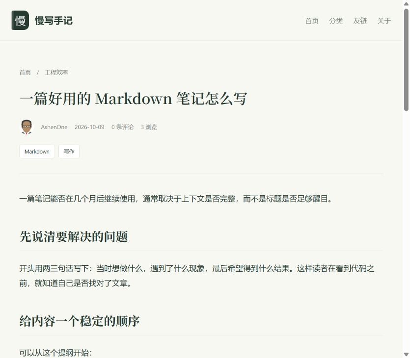
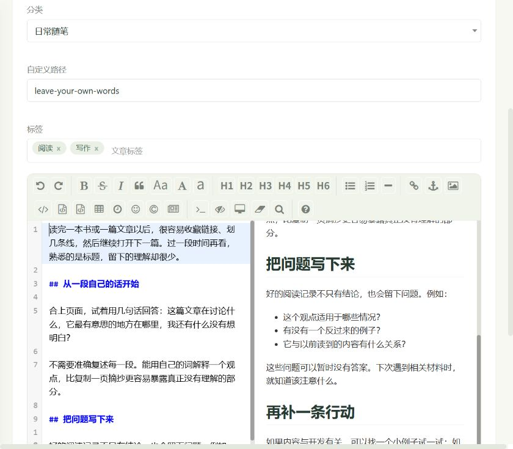
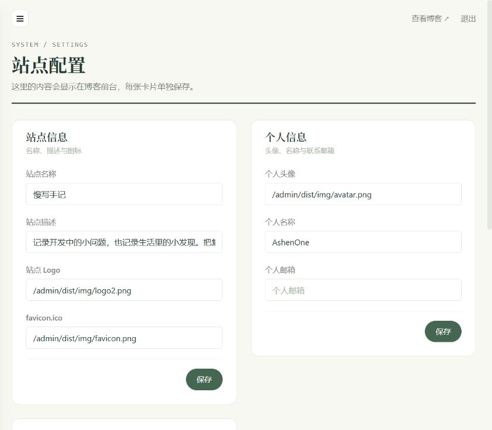

# 慢写手记 · My Blog


一个基于 Spring Boot、MyBatis 和 Thymeleaf 的个人博客学习项目，包含博客前台和内容管理后台。当前站点以“慢写手记”为名，用来记录开发笔记、学习过程和生活中的想法。

**本项目基于 [十三（ZHENFENG13）的 My-Blog](https://github.com/ZHENFENG13/My-Blog) 修改。** 博客的基础功能和项目结构来自原项目，我在此基础上进行依赖升级、界面调整、业务修复和测试补充。这个仓库用于个人学习与练习，记录阅读源码、理解功能和逐步改造的过程。

前端和后台的ui借助claude重构了一下，学习后端的过程中使用了gpt6.1sol辅助学习，这两个文件是gpt生成的，用于辅助学习。ai真好用，😄

- [SQL、Controller 与数据库图解](docs/sql-controller-analysis.md)
- [多表关系与事务图解](docs/table-relations-and-transactions.md)


## 项目来源与学习目的

- 原项目：[ZHENFENG13/My-Blog](https://github.com/ZHENFENG13/My-Blog)。感谢原作者十三提供源码和实现思路。
- 当前项目：保留原项目的博客业务，在学习过程中逐步修改，使用“慢写手记”作为当前站点名称。
- 学习目的：理解一个 Spring Boot 项目从接收请求、处理业务、操作数据库，到渲染页面的完整流程，并通过实际修改和测试加深理解。

这里的改动建立在原项目之上，不代表全部代码由我独立完成。项目仍会随着学习继续完善。

## 项目功能

| 部分 | 功能 |
| --- | --- |
| 博客前台 | 首页与分页、文章详情、分类与标签、文章搜索、Markdown 内容展示、代码高亮、评论、友情链接、关于页面 |
| 管理后台 | 验证码登录、数据概览、文章编辑与发布、草稿、图片上传、分类与标签管理、评论审核与回复、友情链接管理、站点配置、个人信息修改 |

页面由 Thymeleaf 在服务端渲染，部分后台操作通过 JavaScript 请求接口完成。

## 当前改动

- **依赖与框架升级**：升级 Spring Boot 和 MyBatis，适配 Jakarta Servlet API，调整构建配置与 Lombok 注解处理。
- **前台与后台界面调整**：删除了其余主题，只保留 `amaze` 前台主题，调整布局、样式和页面组件，更新后台页面及交互。
- **事务处理修复**：在文章保存、文章更新、分类更新与分类删除中检查关键写入结果，业务失败时抛出异常，使事务能够回滚；通过全局异常处理返回原有 `Result` 格式。
- **站点默认配置迁移**：将原先写在 `ConfigServiceImpl` 中的默认值移到 `application.yml`，通过配置对象读取。
- **回归测试补充**：覆盖事务提交与回滚、异常响应、站点默认配置，以及框架升级后的页面与接口行为。

## 技术栈

| 技术 | 当前用途或版本 |
| --- | --- |
| Java | 编译目标为 Java 17，当前已在 JDK 25 上验证构建与运行 |
| Spring Boot | 4.0.8，应用配置与启动 |
| Spring MVC | 请求处理、表单绑定与接口响应 |
| Thymeleaf | 服务端页面模板 |
| MyBatis Spring Boot Starter | 4.0.1，数据库访问与 SQL 映射 |
| MySQL | 保存文章、分类、标签、评论、站点配置等数据 |
| HikariCP | 数据库连接池 |
| CommonMark | Markdown 内容解析 |
| Hutool Captcha | 登录与评论验证码 |
| Maven | 依赖管理、测试和打包 |
| H2、JUnit、Mockito | 自动化测试 |

## 本地运行

### 1. 准备环境

需要 JDK 17 或更高版本、Maven，以及可连接的 MySQL 数据库。IDEA 的项目 SDK、Maven 使用的 JDK 和运行配置应保持一致。

数据库快照使用了 `utf8mb4_0900_ai_ci` 排序规则，导入环境需要支持这一规则，例如 MySQL 8。

### 2. 导入数据库

数据库脚本位于 [static-files/my_blog_db.sql](static-files/my_blog_db.sql)，包含 8 张业务表的结构和当前数据。

登录 MySQL 客户端后执行以下命令，路径按实际项目位置调整：

```sql
source D:/Program/My-Blog-master/static-files/my_blog_db.sql;
```

脚本会创建 `my_blog_db`（若不存在），并重建其中的业务表；导入已有数据库前，请先备份。管理员账号及密码哈希沿用导出时的数据，登录应使用对应的实际账号密码。

管理员密码使用 BCrypt 保存。**已有数据库**需要先执行一次 [static-files/upgrade-password-column.sql](static-files/upgrade-password-column.sql)，把密码列加长到 100；旧的 MD5 密码仍可登录，登录成功后会自动改存为 BCrypt。示例数据的默认密码很弱，首次登录后请在后台“修改密码”。

SQL 只保存上传图片的引用路径，不包含上传文件。迁移现有站点时，还需要复制实际上传目录。快照内容与截图说明见 [static-files/README.md](static-files/README.md)。

### 3. 修改连接和上传配置

编辑 [application.properties](src/main/resources/application.properties)，按本机环境修改：

```properties
server.port=8080

spring.datasource.url=${DB_URL:jdbc:mysql://localhost:3306/my_blog_db?...}
spring.datasource.username=${DB_USERNAME:root}
spring.datasource.password=${DB_PASSWORD:root}

config.FILE_UPLOAD_DIC=${UPLOAD_DIR:D:/Program/my_blog_update/}
config.theme=amaze
```

`${变量名:默认值}` 表示优先读取环境变量，没有设置时使用冒号后面的默认值。部署到服务器时建议用环境变量传入数据库账号密码，不要把真实密码提交到仓库：

```bash
export DB_USERNAME=blog DB_PASSWORD='强密码' UPLOAD_DIR=/var/my-blog/upload/
```

上传目录不存在时会自动创建（需要应用有写入权限），末尾的 `/` 可写可不写。后台只允许上传 jpg、jpeg、png、gif、webp 图片，文件名会改为随机生成的名字。当前项目只保留 `amaze` 主题，主题配置需要对应实际存在的模板与静态资源。

### 4. 调整站点默认值

站点默认值位于 [application.yml](src/main/resources/application.yml)，例如：

```yaml
blog:
  defaults:
    website-name: "慢写手记"
    website-description: "记录开发中的小问题，也记录生活里的小发现。把复杂的事情讲清楚，把值得留下的想法慢慢写下来。"
    your-name: "AshenOne"
    footer-about: "写代码，也写生活。保持好奇，慢慢积累。"
```

后台保存的站点配置存放在数据库中。读取时优先使用数据库中的非空值；对于已有但内容为空的必填配置，使用 YAML 中的默认值。邮箱和备案号允许留空，缺少的数据库配置记录不会自动创建。

修改 YAML 后需要重启应用；在后台修改站点配置不会改写 YAML 文件。

### 5. 构建与启动

在项目根目录执行：

```bash
mvn clean verify
java -jar target/my-blog-4.0.0-SNAPSHOT.jar
```

也可以在 IDE 中运行 `MyBlogApplication` 启动类。

- 博客前台：<http://localhost:8080/>
- 后台登录：<http://localhost:8080/admin/login>

如果修改了 `server.port`，访问地址也需要使用对应端口。

## 项目结构

```text
My-Blog-master/
├── src/main/java/com/site/blog/my/core/
│   ├── MyBlogApplication.java      # 启动入口
│   ├── config/                    # 应用配置与站点默认值绑定
│   ├── controller/                # 前台、后台与公共请求处理
│   ├── service/                   # 业务接口与实现
│   ├── dao/                       # MyBatis Mapper 接口
│   ├── entity/                    # 数据实体
│   ├── Exception/                 # 业务异常
│   ├── GlobalExceptionHandler/    # 全局异常处理
│   ├── interceptor/               # 后台登录拦截
│   └── util/                      # 通用工具与返回结果
├── src/main/resources/
│   ├── mapper/                    # SQL 映射文件
│   ├── templates/                 # 后台与博客页面模板
│   ├── static/                    # 页面样式、脚本与图片
│   ├── application.properties     # 数据库、端口与上传目录
│   └── application.yml            # 站点默认值
├── src/test/                      # Java 与 JavaScript 回归测试
├── static-files/                  # 项目截图与数据库快照
├── pom.xml                        # Maven 配置
└── LICENSE                        # 许可证
```

## 可以从这里学习什么

1. **请求如何走完一条链路**：从 Controller 进入 Service，再通过 Mapper 和 SQL 访问数据库，最后返回页面或 JSON。
2. **多表关系如何维护**：理解文章、分类、标签以及文章与标签关联表之间的关系，观察一次业务操作为什么需要更新多张表。
3. **事务与异常如何配合**：比较正常提交、SQL 异常和写入结果不符合预期时的行为，理解 Service 抛出异常与全局异常处理各自的职责。
4. **配置与页面如何协作**：观察数据库配置、YAML 默认值和 Thymeleaf 模板如何共同决定页面展示。
5. **如何验证自己的修改**：阅读回归测试，通过提交与回滚后的数据结果、页面渲染和接口响应判断修改是否有效。

可以先从首页查询或文章发布功能入手，沿着一次请求阅读代码，再尝试做一个小改动并验证结果。

## 测试说明

执行 `mvn clean verify` 会运行 Java 自动化测试并完成打包。主要测试包括：

| 测试类 | 验证内容 |
| --- | --- |
| `BlogTransactionTests` | 文章保存与更新的提交、业务失败回滚和 SQL 异常回滚 |
| `CategoryTransactionTests` | 分类更新与删除、多表数据一致性和回滚 |
| `BlogWriteResponseTests` | 业务异常经过全局处理后的 JSON 返回格式 |
| `ConfigDefaultsTests` | YAML 配置绑定、数据库值优先与默认值回填 |
| `FrameworkUpgradeTests` | 模板渲染、登录拦截、表单绑定、图片上传、验证码等升级回归行为 |

事务测试使用独立的 H2 测试数据库。前端交互回归测试可在安装 Node.js 后执行：

```bash
node --test src/test/js/ui-regressions.test.cjs
```

## 界面预览

以下图片来自当前项目的本地运行页面，更多图片见 [项目资料](static-files/README.md)。

### 文章详情



### 后台概览


### Markdown 编辑器



### 站点配置



## 致谢与许可证

感谢 [十三的 My-Blog](https://github.com/ZHENFENG13/My-Blog) 提供项目基础，也感谢项目使用的开源框架与组件。

本仓库保留上游的 [Apache License 2.0](LICENSE)。原项目的代码与贡献归原作者，本仓库记录在其基础上进行的学习和修改。
