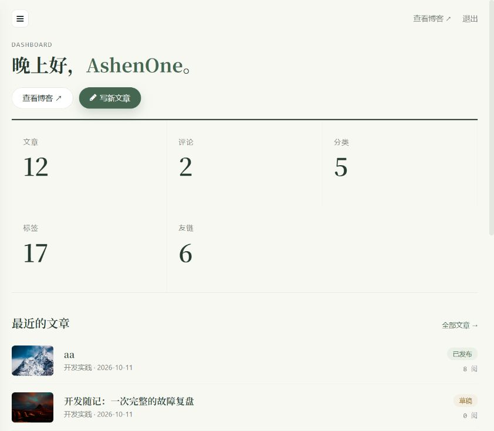
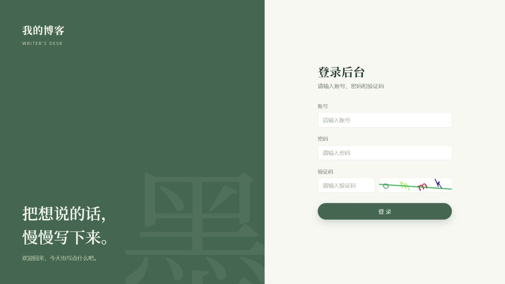
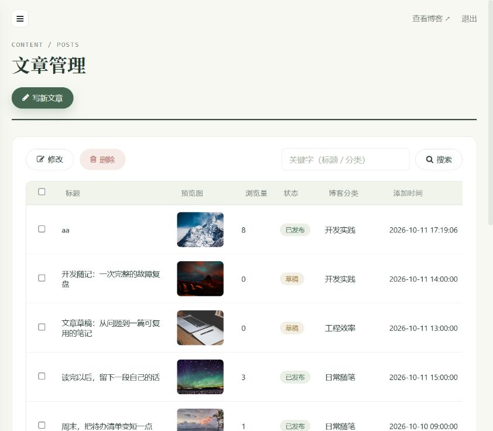
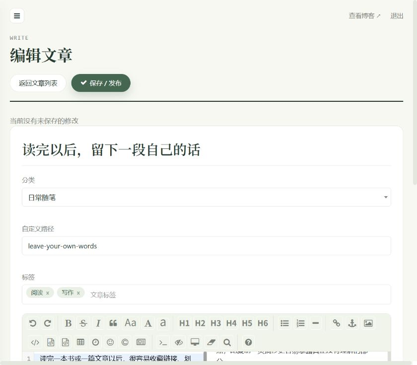
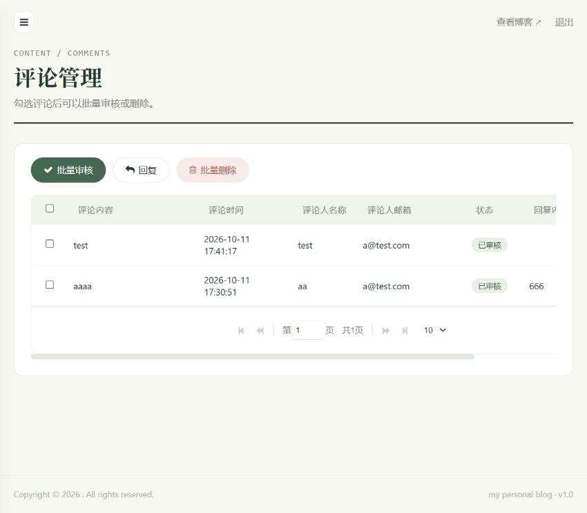
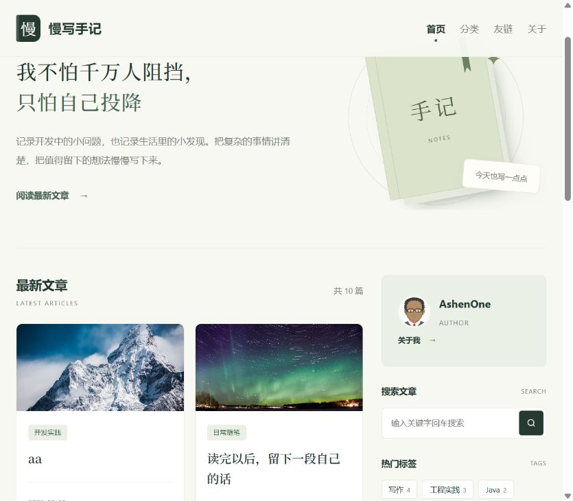
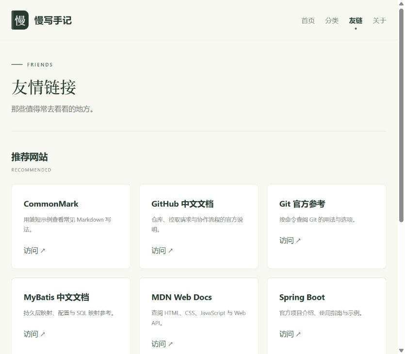

# My Blog

本地项目已升级到 Spring Boot 4.0.8、MyBatis Spring Boot Starter 4.0.1，使用 Jakarta Servlet API。

构建和运行需要 JDK 17 或更高版本，当前已在 JDK 25 上验证。IDEA 的项目 SDK、Maven 使用的 JDK 和运行配置应保持一致。

```bash
mvn clean verify
java -jar target/my-blog-4.0.0-SNAPSHOT.jar
```

启动前，在 `src/main/resources/application.properties` 中配置数据库和图片上传目录。默认服务地址为 `http://localhost:8080`。

升级回归测试位于 `src/test/java/com/site/blog/my/core/FrameworkUpgradeTests.java`，覆盖模板渲染、登录拦截、JSON 日期格式、文章表单绑定、图片上传和访问、验证码生成及错误页。测试中的文章保存使用服务替身，上传文件写入临时目录，不修改真实博客内容。


**坚持不易，各位朋友如果觉得项目还不错的话可以给项目一个 star 吧，也是对我一直更新代码的一种鼓励啦，谢谢各位的支持。**



下方为原仓库的历史版本分支，可用于学习和对照；本地升级版本以上方说明为准。

| 分支名称                                                    | Spring Boot Version |
| ------------------------------------------------------------ | ------------------- |
| [spring-boot-2.3.7](https://github.com/ZHENFENG13/My-Blog/tree/spring-boot-2.3.7) | 2.3.7-RELEASE       |
| [main](https://github.com/ZHENFENG13/My-Blog)            | 2.7.5               |
| [spring-boot-3.x](https://github.com/ZHENFENG13/My-Blog/tree/spring-boot-3.x) | 3.1.0       |

- **你可以拿它作为博客模板，因为 My Blog 界面十分美观简洁，满足私人博客的一切要求；**
- **你也可以把它作为 SpringBoot 技术栈的学习项目，My Blog也足够符合要求，且代码和功能完备；**
- **博客前台仅保留 amaze 主题，页面模板和静态资源按目录组织，方便定制；**
- **技术栈新颖且知识点丰富，学习后可以提升大家对于知识的理解和掌握，对于提升你的市场竞争力有一定的帮助。**

> 更多 Spring Boot 实战项目可以关注十三的另一个代码仓库 [spring-boot-projects](https://github.com/ZHENFENG13/spring-boot-projects)，该仓库中主要是 Spring Boot 的入门学习教程以及一些常用的 Spring Boot 实战项目教程，包括 Spring Boot 使用的各种示例代码，同时也包括一些实战项目的项目源码和效果展示，实战项目包括基本的 web 开发以及目前大家普遍使用的前后端分离实践项目等，后续会根据大家的反馈继续增加一些实战项目源码，摆脱各种 hello world 入门案例的束缚，真正的掌握 Spring Boot 开发。

关注公众号：**程序员十三**，回复"勾搭"进群交流。


## 注意事项

- **数据库文件目录为```static-files/my_blog_db.sql```；**
- **部署后你可以根据自己需求修改版权文案、logo 图片、备案记录等网站基础信息；**
- **My Blog 后台管理系统的默认登陆账号为 admin 默认登陆密码为 123456；**
- **layui 版本的 My-Blog，仓库地址 [My-Blog-layui](https://github.com/ZHENFENG13/My-Blog-layui) ，感兴趣的朋友也可以学习一下；**
- **My Blog 还有一些不完善的地方，鄙人才疏学浅，望见谅；**
- **有任何问题都可以反馈给我，我会尽量完善该项目。**

[](https://travis-ci.org/ZHENFENG13/My-Blog)

[](https://github.com/ZHENFENG13/My-Blog/blob/master/LICENSE)

## 项目演示

- [视频1：My-Blog博客项目简介](https://edu.csdn.net/course/play/29029/406882)
- [视频2：My-Blog博客项目系统演示-1](https://edu.csdn.net/course/play/29029/405864)
- [视频3：My-Blog博客项目系统演示-2](https://edu.csdn.net/course/play/29029/405865)
- [视频4：博客项目预览](https://www.bilibili.com/video/av52551095)

## 开发文档

### 《SpringBoot + Mybatis + Thymeleaf 搭建美观实用的个人博客》(支付减免优惠券码 LSJdK3KT )

[](https://www.shiyanlou.com/courses/1367)

- [**第01课：Spring Boot 搭建简洁实用的个人博客系统导读**](https://www.shiyanlou.com/courses/1367)
- [第02课：快速构建 Spring Boot 应用](https://www.shiyanlou.com/courses/1367)
- [第03课：Spring Boot 项目开发之web项目开发讲解](https://www.shiyanlou.com/courses/1367)
- [第04课：Spring Boot 整合 Thymeleaf 模板引擎](https://www.shiyanlou.com/courses/1367)
- [第05课：Spring Boot 处理文件上传及路径回显](https://www.shiyanlou.com/courses)
- [第06课：Spring Boot 自动配置数据源及操作数据库](https://www.shiyanlou.com/courses/1367)
- [第07课：Spring Boot 整合 MyBatis 操作数据库](https://www.shiyanlou.com/courses/1367)
- [第08课：Mybatis-Generator 自动生成代码](https://www.shiyanlou.com/courses/1367)
- [第09课：Spring Boot 中的事务处理](https://www.shiyanlou.com/courses/1367)
- [第10课：Spring Boot 项目实践之 Ajax 技术使用教程](https://www.shiyanlou.com/courses/1367)
- [第11课：Spring Boot 项目实践之  RESTful API 设计与实现](https://www.shiyanlou.com/courses/1367)
- [第12课：Spring Boot 博客系统项目开发之分页功能实现](https://www.shiyanlou.com/courses/1367)
- [第13课：Spring Boot 博客系统项目开发之验证码功能](https://www.shiyanlou.com/courses/1367)
- [第14课：Spring Boot 博客系统项目开发之登录模块实现](https://www.shiyanlou.com/courses/1367)
- [第15课：Spring Boot 博客系统项目开发之登陆拦截器](https://www.shiyanlou.com/courses/1367)
- [第16课：Spring Boot 博客系统项目开发之分类功能实现](https://www.shiyanlou.com/courses/1367)
- [第17课：Spring Boot 博客系统项目开发之标签功能实现](https://www.shiyanlou.com/courses/1367)
- [第18课：Spring Boot 博客系统项目开发之文章编辑功能](https://www.shiyanlou.com/courses/1367)
- [第19课：Spring Boot 博客系统项目开发之文章编辑完善](https://www.shiyanlou.com/courses/1367)
- [第20课：Spring Boot 博客系统项目开发之文章模块实现](https://www.shiyanlou.com/courses/1367)
- [第21课：Spring Boot 博客系统项目开发之友链模块实现](https://www.shiyanlou.com/courses/1367)
- [第22课：Spring Boot 博客系统项目开发之网站首页制作](https://www.shiyanlou.com/courses/1367)
- [第23课：Spring Boot 博客系统项目开发之分页及侧边栏制作](https://www.shiyanlou.com/courses/1367)
- [第24课：Spring Boot 博客系统项目开发之搜索页面制作](https://www.shiyanlou.com/courses/1367)
- [第25课：Spring Boot 博客系统项目开发之文章详情页制作](https://www.shiyanlou.com/courses/1367)
- [第26课：Spring Boot 博客系统项目开发之错误页面制作](https://www.shiyanlou.com/courses/1367)
- [第27课：Spring Boot 博客系统项目开发之评论功能实现](https://www.shiyanlou.com/courses/1367)
- [第28课：Spring Boot 博客系统项目开发之项目打包部署](https://www.shiyanlou.com/courses/1367)

## 联系作者

> 大家有任何问题或者建议都可以在 [issues](https://github.com/ZHENFENG13/My-Blog/issues) 中反馈给我，我会慢慢完善这个项目。

- 我的邮箱：2449207463@qq.com
- QQ技术交流群：719099151 796794009 881582471

> My-Blog 在 GitHub 和国内的码云都创建了代码仓库，如果有人访问 GitHub 比较慢的话，建议在 Gitee 上查看该项目，两个仓库会保持同步更新。

- [My-Blog in GitHub](https://github.com/ZHENFENG13/My-Blog)
- [My-Blog in Gitee](https://gitee.com/zhenfeng13/My-Blog)

## 效果预览

### 后台管理页面

- 登录页

	

- 后台首页

	

- 文章管理

	

- 文章编辑

	

- 评论管理

	

- 系统配置

	

### 博客展示页面

项目当前仅保留 **amaze 主题**，效果如下：

#### amaze 主题

- 首页

  

- 文章浏览

  

- 友情链接

  
  
主题由 `MyBlogController` 中的 `THEME` 常量固定为 `amaze`。页面模板位于
`src/main/resources/templates/blog/amaze/`，主题资源位于
`src/main/resources/static/blog/amaze/`，公共脚本位于 `static/blog/plugins/`。

## 感谢

- [spring-projects](https://github.com/spring-projects/spring-boot)
- [ColorlibHQ](https://github.com/ColorlibHQ/AdminLTE)
- [tonytomov](https://github.com/tonytomov/jqGrid)
- [pandao](https://github.com/pandao/editor.md)
- [DONGChuan](https://github.com/DONGChuan/Yummy-Jekyll)
- [zjhch123](https://github.com/zjhch123/solo-skin-amaze)
- [t4t5](https://github.com/t4t5/sweetalert)
