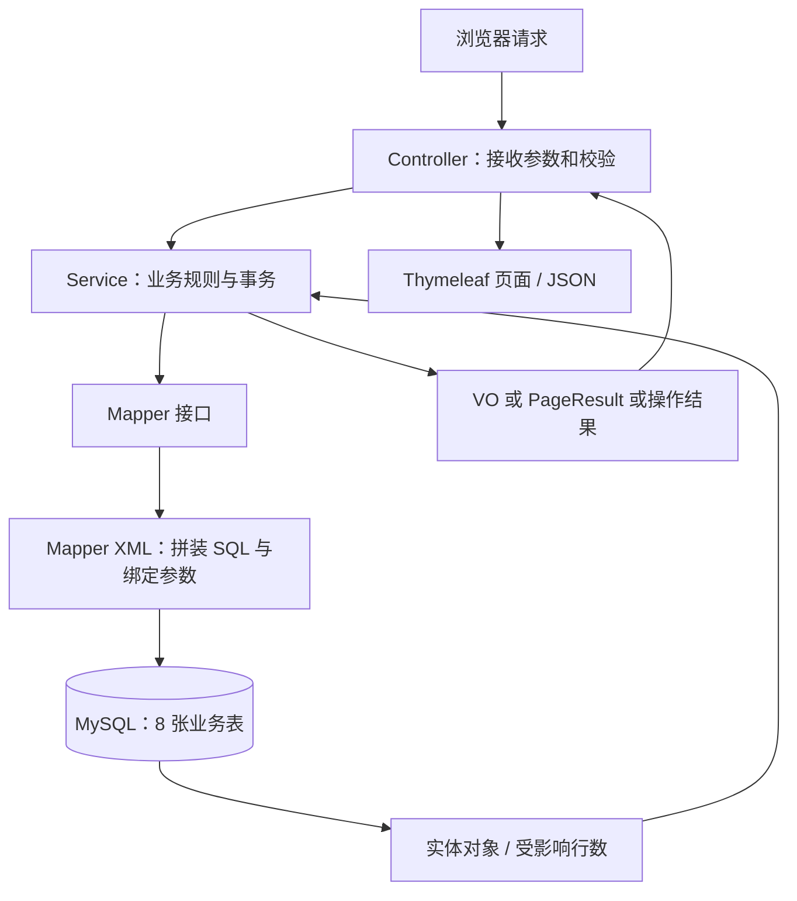
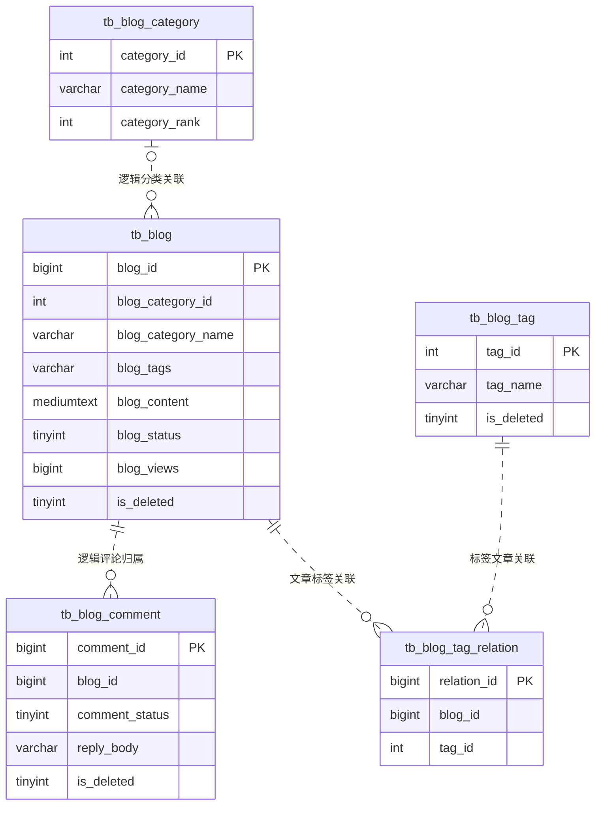
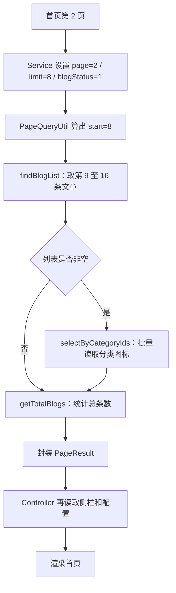
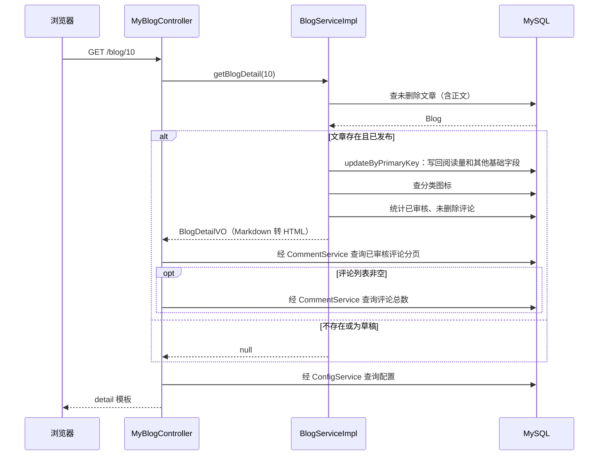
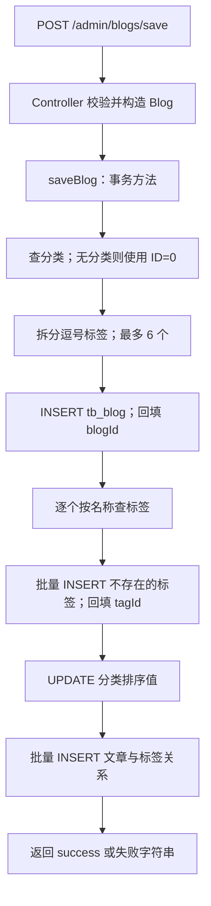
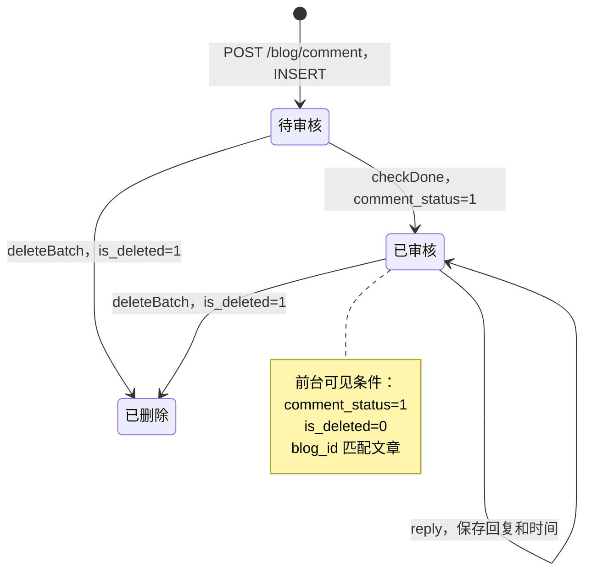

# 项目 SQL、Controller 与数据库图解

分析日期：2026-10-11。范围：当前工作区的 Controller、ServiceImpl、8 个 MyBatis XML Mapper，以及 `static-files/my_blog_db.sql`。这是一份静态代码分析，未连接运行中的数据库；表结构、索引和字符集结论指仓库脚本，实际数据库可能已有额外修改。SQL 示例中的 `?` 表示绑定参数，省略列清单的示例用于讲解，不是逐字复制。

## 1. 先理解 SQL 在哪里执行

Controller 接收 HTTP 参数、校验输入并选择页面或 JSON 响应；Service 决定过滤条件、跨表操作、事务和对象转换；Mapper 接口通过 namespace 与 XML 的 SQL 绑定；数据库执行 SQL 后返回数据或受影响行数。



例如 `MyBlogController.page()` → `BlogServiceImpl.getBlogsForIndexPage()` → `BlogMapper.findBlogList()` → XML 中 `<select id="findBlogList">`。Controller 中没有直接写 SQL，一个请求可以触发多条 SQL。

## 2. 数据库表与关系

| 表 | 主键 | 作用 | 重要字段 |
|---|---|---|---|
| tb_blog | blog_id | 文章主体 | blog_content、blog_category_id、blog_category_name、blog_tags、blog_status、blog_views |
| tb_blog_category | category_id | 分类 | category_name、category_icon、category_rank |
| tb_blog_tag | tag_id | 标签字典 | tag_name |
| tb_blog_tag_relation | relation_id | 文章与标签的多对多关系 | blog_id、tag_id |
| tb_blog_comment | comment_id | 评论及管理员回复 | blog_id、comment_status、reply_body |
| tb_admin_user | admin_user_id | 管理员登录与资料 | login_user_name、login_password、locked |
| tb_config | config_name | 网站配置键值对 | config_value |
| tb_link | link_id | 友情链接 | link_type、link_rank |

脚本另外有 `generator_test`、`jdbc_test`、`tb_test`，本次检查的业务 Mapper 未使用它们。管理员表没有通过作者 ID 关联文章，当前数据模型没有文章作者外键。



图中是业务上的逻辑关联，脚本没有声明 FOREIGN KEY，不保证引用完整性。分类 ID=0 是 Service 的“默认分类”约定，不要求分类表存在 ID=0 的行。没有外键意味着评论表也可能出现引用不存在文章的行。

文章保存两种冗余数据：`blog_category_name` 用于列表展示和搜索；`blog_tags` 是逗号分隔的标签文本，供详情展示。按标签找文章则使用关系表，不使用 `blog_tags LIKE ...`。维护时必须让文本和关系表保持一致。

## 3. 前台 Controller 如何驱动 SQL

下表只列主业务查询。首页和列表页还会查询最新文章、热门文章、热门标签和配置；非空文章列表会额外批量查分类图标。

| HTTP 请求 / MyBlogController 方法 | Service 方法 | 主要 Mapper 方法 | 数据库含义 |
|---|---|---|---|
| GET /、/index、/page/{pageNum} / index、page | getBlogsForIndexPage | findBlogList + getTotalBlogs | 已发布、未删除文章，每页 8 条 |
| 首页、标签/分类/搜索列表的侧栏 | getBlogListForIndexPage | findBlogListByType | type=1 最新、type=0 最热，各取 9 条 |
| 前台热门标签 | getBlogTagCountForIndex | BlogTagMapper.getTagCount | 三表关联，按有效已发布文章数取前 20 个标签 |
| GET /categories / categories | getAllCategories | findCategoryList(null) | 所有未删除分类，排序值降序、创建时间降序 |
| GET /blog/{blogId}、/article/{blogId} / detail | getBlogDetail | selectByPrimaryKey + updateByPrimaryKey | 查正文；Service 检查发布状态后增加阅读量 |
| GET /{subUrl} / detail 重载 | getBlogDetailBySubUrl | selectBySubUrl + updateByPrimaryKey | 自定义路径取一篇文章，再检查发布状态并增加阅读量 |
| GET /tag/{tagName}[/{page}] / tag | getBlogsPageByTag | selectByTagName + getBlogsPageByTagId + getTotalBlogsByTagId | 标签名转 ID，再通过关系表查文章，每页 9 条 |
| GET /category/{categoryName}[/{page}] / category | getBlogsPageByCategory | selectByCategoryName + findBlogList + getTotalBlogs | 分类名转 ID，再筛选已发布文章，每页 9 条 |
| GET /search/{keyword}[/{page}] / search | getBlogsPageBySearch | findBlogList + getTotalBlogs | 标题或冗余分类名模糊搜索，每页 9 条 |
| GET /link / link | getLinksForLinkPage | findLinkList(null) | 查未删除链接，在 Java 中按 link_type 分组 |
| POST /blog/comment / comment | addComment | BlogCommentMapper.insertSelective | 插入评论，默认未审核 |
| ID 文章详情的评论列表 | getCommentPageByBlogIdAndPageNum | findBlogCommentList + getTotalBlogComments | 当前文章、已审核、未删除评论，每页 8 条；列表为空时不查总数 |
| 页面配置 | getAllConfigs | BlogConfigMapper.selectAll | 全量读取配置，Java 转 Map 并处理部分空配置值 |

`/{subUrl}` 的详情分支没有像 `/blog/{blogId}` 分支那样设置评论分页数据，但详情 VO 仍查询已审核评论总数。

### 3.1 首页分页：一个通用 SQL，参数决定业务

```sql
-- findBlogList：首页第 2 页的等价查询，省略实际基础列清单
SELECT blog_id, blog_title, blog_category_id, blog_category_name, blog_tags
FROM tb_blog
WHERE is_deleted = 0 AND blog_status = 1
ORDER BY blog_id DESC
LIMIT 8, 8;

-- getTotalBlogs：同样的筛选条件，但不分页
SELECT COUNT(*) FROM tb_blog
WHERE is_deleted = 0 AND blog_status = 1;
```

`PageQueryUtil` 计算 `start=(page-1)*limit`。列表查询得到当前页，COUNT 查询得到总条数；PageResult 同时携带列表、总数、每页条数和页码。列表不取 `mediumtext` 正文；详情通过 `ResultMapWithBLOBs` 多取 `blog_content`。



非空首页列表通常执行 7 次 Mapper SQL：文章列表、分类图标、文章总数、最新文章、热门文章、热门标签、配置。分类图标采用一次 `IN (...)` 批量查询，而非每篇文章单独查分类。

### 3.2 搜索：实际搜索范围

```sql
SELECT blog_id, blog_title, blog_category_name
FROM tb_blog
WHERE is_deleted = 0
  AND (blog_title LIKE CONCAT('%', ?, '%')
       OR blog_category_name LIKE CONCAT('%', ?, '%'))
  AND blog_status = 1
ORDER BY blog_id DESC
LIMIT ?, ?;
```

搜索匹配标题或分类名称，不匹配正文与标签。括号保证 OR 的两边都受删除状态、发布状态限制。后台文章列表复用同一 SQL，但 Service 不强制添加 `blogStatus=1`，所以默认能看到草稿。

### 3.3 标签页：子查询负责找归属

```sql
SELECT blog_id, blog_title, blog_tags
FROM tb_blog
WHERE blog_id IN (
    SELECT blog_id FROM tb_blog_tag_relation WHERE tag_id = ?
)
  AND blog_status = 1 AND is_deleted = 0
ORDER BY blog_id DESC
LIMIT ?, ?;
```

假设标签 Java 的 ID=3，关系表有 `(文章10,标签3)`、`(文章20,标签3)`，子查询产生候选文章 ID 10 和 20，外层再过滤发布与删除状态。IN 只判断归属，即使关系表有重复关系，也不会把外层文章重复返回。

热门标签 SQL 则聚合数量：

```sql
SELECT t.tag_id, t.tag_name, COUNT(DISTINCT b.blog_id) AS tag_count
FROM tb_blog_tag t
INNER JOIN tb_blog_tag_relation tr ON tr.tag_id = t.tag_id
INNER JOIN tb_blog b ON b.blog_id = tr.blog_id
WHERE t.is_deleted = 0 AND b.is_deleted = 0 AND b.blog_status = 1
GROUP BY t.tag_id, t.tag_name
ORDER BY tag_count DESC, t.tag_id ASC
LIMIT 20;
```

INNER JOIN 排除没有有效文章的标签；GROUP BY 把同标签的关联行聚到一起；COUNT(DISTINCT ...) 避免重复关系让文章数虚高；同数量时按标签 ID 排序。当前版本已经过滤草稿和已删除文章。

### 3.4 详情页：读请求包含数据库写入



SQL 按主键查询本身不限制发布状态，发布判断位于 Service，便于后台编辑复用同一个主键查询。ID 详情的 Controller 在 VO 为 null 时仍返回详情模板。

## 4. 后台 Controller 与写操作

| Controller / 路径（统一加 /admin） | Service 行为 | SQL / 表 |
|---|---|---|
| AdminController /login POST | 密码先做 MD5，再查询未锁定账号 | AdminUserMapper.login：用户名、密码、locked=0 |
| AdminController /index GET | 读取 5 项后台计数 | 分类、文章、友链、标签、评论各 COUNT；未强制发布/审核状态 |
| AdminController /profile GET | 查当前管理员 | selectByPrimaryKey |
| AdminController /profile/password、/profile/name POST | 查账号，校验并更新 | selectByPrimaryKey + updateByPrimaryKeySelective |
| BlogController /blogs/list GET | 后台文章分页 | findBlogList + getTotalBlogs |
| BlogController /blogs/edit[/{blogId}] GET | 加载分类，编辑时另查文章 | findCategoryList；selectByPrimaryKey |
| BlogController /blogs/save POST | 保存文章、标签、关系、分类排序值 | insertSelective、selectByTagName、batchInsertBlogTag、updateByPrimaryKeySelective、关系 batchInsert |
| BlogController /blogs/update POST | 读取旧文章，重建标签关系并更新文章 | selectByPrimaryKey、标签查询/插入、deleteByBlogId、关系 batchInsert、文章 selective UPDATE |
| BlogController /blogs/delete POST | 软删除文章 | UPDATE tb_blog SET is_deleted=1 WHERE blog_id IN (...) |
| CategoryController /categories/list GET | 分类分页 | findCategoryList + getTotalCategories |
| CategoryController /categories/save POST | 先按名称检查，再创建 | selectByCategoryName + insertSelective |
| CategoryController /categories/update POST | 修改分类，同步文章的分类冗余名称 | selectByPrimaryKey + BlogMapper.updateBlogCategorys + 分类 selective UPDATE |
| CategoryController /categories/delete POST | 文章改为默认分类，再软删除分类 | updateBlogCategorys + deleteBatch |
| TagController /tags/list GET | 标签分页 | findTagList + getTotalTags |
| TagController /tags/save POST | 先按名称检查，再创建 | selectByTagName + insertSelective |
| TagController /tags/delete POST | 任一待删标签仍有关系时，拒绝整批删除 | selectDistinctTagIds + 条件执行 deleteBatch |
| CommentController /comments/list GET | 评论分页 | findBlogCommentList + getTotalBlogComments |
| CommentController /comments/checkDone POST | 批量审核 | UPDATE comment_status=1；只更新原状态为 0 的记录 |
| CommentController /comments/reply POST | 只给已审核、未删除评论回复 | selectByPrimaryKey + updateByPrimaryKeySelective |
| CommentController /comments/delete POST | 软删除评论 | deleteBatch |
| LinkController /links/list GET | 友链分页 | findLinkList + getTotalLinks |
| LinkController /links/save POST | 新建友链 | insertSelective |
| LinkController /links/info/{id} GET | 读取一条友链 | selectByPrimaryKey |
| LinkController /links/update POST | 读取并修改友链 | selectByPrimaryKey + updateByPrimaryKeySelective |
| LinkController /links/delete POST | 软删除友链 | deleteBatch |
| ConfigurationController /configurations GET | 配置页加载 | selectAll |
| ConfigurationController /configurations/website、/userInfo、/footer POST | 逐项读取并更新已有配置 | selectByPrimaryKey + updateByPrimaryKeySelective；不创建缺失配置项 |

UploadController、BlogController 的 Markdown 图片上传方法操作文件；CommonController 操作验证码与 Session；ErrorPageController 选择错误模板，这些分支不执行业务 SQL。后台部分 GET 页面入口仅返回模板，数据由后续 `/list` 请求加载。管理员退出仅清理 Session。

### 4.1 保存文章的跨表事务



一篇文章可以对应多个关系行，例如文章 ID=10，标签 ID=3、5，对应：

```sql
INSERT INTO tb_blog_tag_relation(blog_id, tag_id)
VALUES (10, 3), (10, 5);
```

文章 INSERT 的 `useGeneratedKeys=true` 把数据库产生的主键写回 Java 的 `blogId`，后续关系 INSERT 才能引用它。批量标签 INSERT 同样配置了主键回填；实际行为需结合驱动验证，本次未做数据库运行验证。

编辑文章采用“删除旧关系，再插入新关系”，是关系表的物理 DELETE；这与文章的软删除不同。源码实际写入顺序是：插入新标签 → 更新分类排序 → 删除旧关系 → 插入新关系 → 更新文章。不能只根据方法里的流程注释判断顺序。

saveBlog、updateBlog、updateCategory、分类 deleteBatch 标记了 `@Transactional`。通常运行时异常会触发回滚；返回“保存失败”“修改失败”或 false 本身不会要求回滚。若前面已经写库、后面受影响行数为 0 后正常返回，仍可能提交先前操作。

### 4.2 评论生命周期



回复保存在原评论行的 `reply_body` 和 `reply_create_time`，没有独立的回复表，也不是树形评论结构。新增评论依靠数据库默认值进入待审核状态。

## 5. MyBatis SQL 写法的含义

| XML 写法 | 当前项目的作用 |
|---|---|
| namespace + id | 把 Mapper 接口方法绑定到对应 SQL |
| resultMap | 把 `blog_category_id` 映射为 Java 的 `blogCategoryId` 等字段 |
| include Base_Column_List | 复用基础列清单，减少重复 |
| ResultMapWithBLOBs + Blob_Column_List | 详情额外读取正文；这里的正文是 mediumtext，并非二进制文件 |
| `#{...}` | 绑定参数；用户值不直接变成 SQL 语法 |
| if | 参数非空时才添加过滤或写入字段 |
| trim | 动态 INSERT 的列和值清理尾逗号 |
| set | 动态 UPDATE 的 SET 子句清理尾逗号 |
| foreach | 生成 IN 列表或多行 VALUES |
| insertSelective | 只插入非 null 字段，省略字段可使用数据库默认值 |
| updateByPrimaryKeySelective | 只更新非 null 字段；null 不表示把数据库列清空 |
| useGeneratedKeys | 把自增主键回填到对象 |

SQL XML 中未发现 `${...}` 直接拼接参数。`@Value("${...}")` 是 Spring 配置占位符，与 SQL 拼接无关。LIKE 的 `%`、`_` 仍是通配符，绑定参数不会自动转义它们。

Mapper 内还有一些生成式 insert、updateByPrimaryKey、单条 delete 等方法。XML 定义存在不等于当前 Controller 会调用它；业务路径主要使用 selective、分页和批量方法，附录单独记录源码中的调用线索。

## 6. 从数据库角度看当前实现

### 6.1 状态字段与软删除

- 文章 `blog_status`：0 草稿，1 发布。
- 评论 `comment_status`：0 未审核，1 已审核。
- 文章 `enable_comment`：0 允许，1 不允许，语义与一般布尔开关直觉相反。
- 文章、分类、标签、评论、友链以 `is_deleted` 软删除；关系表没有这个字段。
- 软删除文章不会删除评论或标签关系。热门标签 SQL 已排除已删除文章，但标签删除检查仍会看到保留关系，因此只关联已删文章的标签也可能无法删除。

### 6.2 已确认的正确性细节

1. **阅读量存在并发丢失更新与旧值覆盖风险。** 当前先读 Blog，再在 Java 做 +1，最后 `updateByPrimaryKey` 写回所有基础字段。两个请求读到相同阅读量，可能只增加 1；与后台编辑交错时也可能把读到的旧标题、分类等写回。更合理的是仅执行 `SET blog_views=blog_views+1` 的原子更新。
2. **文章 selective UPDATE 重复设置正文。** BlogMapper.xml 中 `blog_content` 的非空判断出现两次，生成两个同名列赋值，内容相同但冗余，建议保留一处。
3. **分类排序值不等于当前文章数量。** 新建文章和每次编辑都会 +1，删除没有 -1，不能把 category_rank 当实时篇数。它目前更接近累计操作排序值。
4. **自定义 URL 没有唯一约束。** 按路径查询 `LIMIT 1` 且没有排序；重复路径对应哪篇文章没有明确保证，第一条若是草稿，Service 会返回 null，即使还有同路径已发布文章。
5. **标签、分类名称的查重依赖先查后插。** 脚本没有名称唯一索引，并发创建仍可能重复。标签输入也未逐项去空白和去重，同一请求可能创建重复新标签或重复关系。
6. **评论写入不查询文章。** Controller 校验部分参数后直接 INSERT；没有在该调用链验证文章存在、已发布、未删除或 enable_comment=0。模板开关不能替代写入校验。
7. **可选 subUrl 存在空值处理缺口。** Controller 标记 `required=false`，但直接调用 `blogSubUrl.trim()`；参数缺失时可能在执行 SQL 前抛异常。数据库又要求该列 NOT NULL，需要统一空字符串或有效路径约定。
8. **更新时间没有自动维护保证。** 脚本 update_time 只有默认值，没有 ON UPDATE；编辑文章没有显式设置新 updateTime，因此不能把它可靠地当最近编辑时间。
9. **友链排序没有使用 link_rank。** 字段注释说用于排序，findLinkList 实际按 link_id DESC。

以上是静态代码判断，未通过并发测试或实际数据库执行验证；本次未修改业务实现。

### 6.3 索引与性能

脚本中的 8 张业务表都只有主键，没有业务字段的二级索引、唯一约束或外键。可能影响标签名/分类名/路径查找、关系表归属查询、评论分页和热门文章排序。以下只是候选方向，应以实际数据量和 EXPLAIN 为依据：

| 查询场景 | 可评估的索引方向 |
|---|---|
| 首页、分类文章列表 | `(is_deleted, blog_status, blog_id)`；分类列表另评估 `(blog_category_id, is_deleted, blog_status, blog_id)` |
| 热门文章 | `(is_deleted, blog_status, blog_views)` |
| 标签查文章 | 关系表 `(tag_id, blog_id)` |
| 按文章删除关系、防止重复关系 | 关系表唯一 `(blog_id, tag_id)`；建立前清理重复数据 |
| 评论详情分页 | `(blog_id, comment_status, is_deleted, comment_id)` |
| 标签名、分类名、文章路径查找 | 名称/路径索引；唯一性策略需要先考虑重复数据、软删除和空路径 |

以 `%关键词%` 开头的 LIKE 通常不能直接利用普通 B-tree 索引进行前缀范围定位。大数据量搜索可另行评估全文搜索；当前没有执行计划，不能给出真实耗时或断言某条查询必定全表扫描。深页 OFFSET 分页也可能需要扫描并跳过大量结果。

脚本使用 InnoDB 与 `utf8`，不是显式 utf8mb4；如果要稳定保存 emoji 或四字节字符，应核对实际 MySQL 的库、表、列及连接字符集后再设计迁移。

## 7. 源码阅读路线

1. Controller：`src/main/java/com/site/blog/my/core/controller/blog/MyBlogController.java` 与 `controller/admin/`。
2. 文章业务：`src/main/java/com/site/blog/my/core/service/impl/BlogServiceImpl.java`。
3. 分类、标签、评论维护：同目录下的 CategoryServiceImpl、TagServiceImpl、CommentServiceImpl。
4. SQL：`src/main/resources/mapper/`。
5. 分页偏移：`src/main/java/com/site/blog/my/core/util/PageQueryUtil.java`。
6. 表定义：`static-files/my_blog_db.sql`。

建议先跟踪一次首页请求，再跟踪一次保存文章请求：前者展示“参数怎样改变 SQL”，后者展示“一个 Controller 操作怎样同时修改多张表”。

## 附录：完整 Mapper SQL 清单与调用线索

下表通过 Mapper 类型对应的 Java 字段名匹配调用；“未发现”表示当前 src/main/java 未发现直接调用，并不证明任何未来或外部代码均不会调用。行号以分析时源码为准。

| Mapper / SQL ID | 类型 | Java 调用位置 |
|---|---|---|
| AdminUserMapper.login | SELECT | AdminUserServiceImpl.java:20 |
| AdminUserMapper.selectByPrimaryKey | SELECT | AdminUserServiceImpl.java:25、AdminUserServiceImpl.java:30、AdminUserServiceImpl.java:50 |
| AdminUserMapper.insert | INSERT | 未发现直接调用 |
| AdminUserMapper.insertSelective | INSERT | 未发现直接调用 |
| AdminUserMapper.updateByPrimaryKeySelective | UPDATE | AdminUserServiceImpl.java:39、AdminUserServiceImpl.java:56 |
| AdminUserMapper.updateByPrimaryKey | UPDATE | 未发现直接调用 |
| BlogCategoryMapper.findCategoryList | SELECT | CategoryServiceImpl.java:25、CategoryServiceImpl.java:76 |
| BlogCategoryMapper.getTotalCategories | SELECT | CategoryServiceImpl.java:26、CategoryServiceImpl.java:33 |
| BlogCategoryMapper.selectByPrimaryKey | SELECT | BlogServiceImpl.java:134、BlogServiceImpl.java:319、BlogServiceImpl.java:43、CategoryServiceImpl.java:51 |
| BlogCategoryMapper.selectByCategoryIds | SELECT | BlogServiceImpl.java:349 |
| BlogCategoryMapper.selectByCategoryName | SELECT | BlogServiceImpl.java:254、CategoryServiceImpl.java:38 |
| BlogCategoryMapper.deleteByPrimaryKey | UPDATE | 未发现直接调用 |
| BlogCategoryMapper.deleteBatch | UPDATE | CategoryServiceImpl.java:71 |
| BlogCategoryMapper.insert | INSERT | 未发现直接调用 |
| BlogCategoryMapper.insertSelective | INSERT | CategoryServiceImpl.java:43 |
| BlogCategoryMapper.updateByPrimaryKeySelective | UPDATE | BlogServiceImpl.java:181、BlogServiceImpl.java:80、CategoryServiceImpl.java:57 |
| BlogCategoryMapper.updateByPrimaryKey | UPDATE | 未发现直接调用 |
| BlogCommentMapper.findBlogCommentList | SELECT | CommentServiceImpl.java:29、CommentServiceImpl.java:74 |
| BlogCommentMapper.getTotalBlogComments | SELECT | BlogServiceImpl.java:337、CommentServiceImpl.java:30、CommentServiceImpl.java:37、CommentServiceImpl.java:76 |
| BlogCommentMapper.selectByPrimaryKey | SELECT | CommentServiceImpl.java:52 |
| BlogCommentMapper.deleteByPrimaryKey | UPDATE | 未发现直接调用 |
| BlogCommentMapper.checkDone | UPDATE | CommentServiceImpl.java:42 |
| BlogCommentMapper.deleteBatch | UPDATE | CommentServiceImpl.java:47 |
| BlogCommentMapper.insert | INSERT | 未发现直接调用 |
| BlogCommentMapper.insertSelective | INSERT | CommentServiceImpl.java:24 |
| BlogCommentMapper.updateByPrimaryKeySelective | UPDATE | CommentServiceImpl.java:57 |
| BlogCommentMapper.updateByPrimaryKey | UPDATE | 未发现直接调用 |
| BlogConfigMapper.selectByPrimaryKey | SELECT | ConfigServiceImpl.java:37 |
| BlogConfigMapper.selectAll | SELECT | ConfigServiceImpl.java:49 |
| BlogConfigMapper.updateByPrimaryKeySelective | UPDATE | ConfigServiceImpl.java:41 |
| BlogLinkMapper.selectByPrimaryKey | SELECT | LinkServiceImpl.java:42 |
| BlogLinkMapper.deleteByPrimaryKey | UPDATE | 未发现直接调用 |
| BlogLinkMapper.deleteBatch | UPDATE | LinkServiceImpl.java:52 |
| BlogLinkMapper.findLinkList | SELECT | LinkServiceImpl.java:24、LinkServiceImpl.java:58 |
| BlogLinkMapper.getTotalLinks | SELECT | LinkServiceImpl.java:25、LinkServiceImpl.java:32 |
| BlogLinkMapper.insert | INSERT | 未发现直接调用 |
| BlogLinkMapper.insertSelective | INSERT | LinkServiceImpl.java:37 |
| BlogLinkMapper.updateByPrimaryKeySelective | UPDATE | LinkServiceImpl.java:47 |
| BlogLinkMapper.updateByPrimaryKey | UPDATE | 未发现直接调用 |
| BlogMapper.selectByPrimaryKey | SELECT | BlogServiceImpl.java:118、BlogServiceImpl.java:124、BlogServiceImpl.java:222 |
| BlogMapper.findBlogList | SELECT | BlogServiceImpl.java:100、BlogServiceImpl.java:199、BlogServiceImpl.java:266、BlogServiceImpl.java:285 |
| BlogMapper.getTotalBlogs | SELECT | BlogServiceImpl.java:101、BlogServiceImpl.java:113、BlogServiceImpl.java:201、BlogServiceImpl.java:268、BlogServiceImpl.java:287 |
| BlogMapper.findBlogListByType | SELECT | BlogServiceImpl.java:209 |
| BlogMapper.getBlogsPageByTagId | SELECT | BlogServiceImpl.java:241 |
| BlogMapper.getTotalBlogsByTagId | SELECT | BlogServiceImpl.java:243 |
| BlogMapper.selectBySubUrl | SELECT | BlogServiceImpl.java:296 |
| BlogMapper.deleteByPrimaryKey | UPDATE | 未发现直接调用 |
| BlogMapper.deleteBatch | UPDATE | BlogServiceImpl.java:108 |
| BlogMapper.insert | INSERT | 未发现直接调用 |
| BlogMapper.insertSelective | INSERT | BlogServiceImpl.java:59 |
| BlogMapper.updateByPrimaryKeySelective | UPDATE | BlogServiceImpl.java:185 |
| BlogMapper.updateByPrimaryKeyWithBLOBs | UPDATE | 未发现直接调用 |
| BlogMapper.updateByPrimaryKey | UPDATE | BlogServiceImpl.java:315 |
| BlogMapper.updateBlogCategorys | UPDATE | CategoryServiceImpl.java:56、CategoryServiceImpl.java:69 |
| BlogTagMapper.findTagList | SELECT | TagServiceImpl.java:27 |
| BlogTagMapper.getTagCount | SELECT | TagServiceImpl.java:62 |
| BlogTagMapper.getTotalTags | SELECT | TagServiceImpl.java:28、TagServiceImpl.java:35 |
| BlogTagMapper.selectByPrimaryKey | SELECT | 未发现直接调用 |
| BlogTagMapper.selectByTagName | SELECT | BlogServiceImpl.java:156、BlogServiceImpl.java:234、BlogServiceImpl.java:65、TagServiceImpl.java:40 |
| BlogTagMapper.deleteByPrimaryKey | UPDATE | 未发现直接调用 |
| BlogTagMapper.deleteBatch | UPDATE | TagServiceImpl.java:57 |
| BlogTagMapper.batchInsertBlogTag | INSERT | BlogServiceImpl.java:168、BlogServiceImpl.java:77 |
| BlogTagMapper.insert | INSERT | 未发现直接调用 |
| BlogTagMapper.insertSelective | INSERT | TagServiceImpl.java:44 |
| BlogTagMapper.updateByPrimaryKeySelective | UPDATE | 未发现直接调用 |
| BlogTagMapper.updateByPrimaryKey | UPDATE | 未发现直接调用 |
| BlogTagRelationMapper.selectByPrimaryKey | SELECT | 未发现直接调用 |
| BlogTagRelationMapper.selectByBlogIdAndTagId | SELECT | 未发现直接调用 |
| BlogTagRelationMapper.selectDistinctTagIds | SELECT | TagServiceImpl.java:52 |
| BlogTagRelationMapper.deleteByPrimaryKey | DELETE | 未发现直接调用 |
| BlogTagRelationMapper.deleteByBlogId | DELETE | BlogServiceImpl.java:183 |
| BlogTagRelationMapper.insert | INSERT | 未发现直接调用 |
| BlogTagRelationMapper.insertSelective | INSERT | 未发现直接调用 |
| BlogTagRelationMapper.batchInsert | INSERT | BlogServiceImpl.java:184、BlogServiceImpl.java:91 |
| BlogTagRelationMapper.updateByPrimaryKeySelective | UPDATE | 未发现直接调用 |
| BlogTagRelationMapper.updateByPrimaryKey | UPDATE | 未发现直接调用 |
