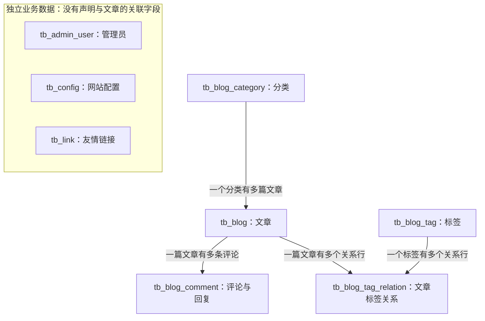
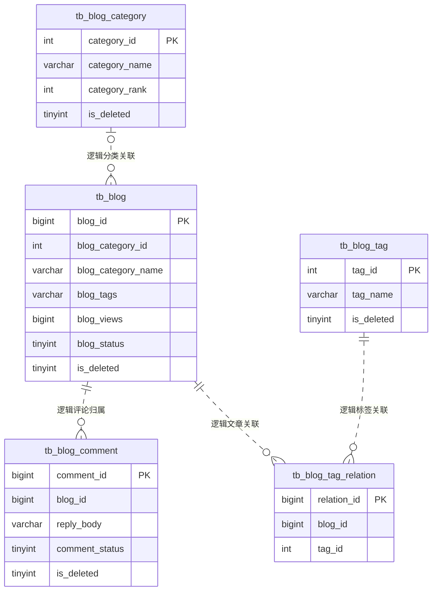
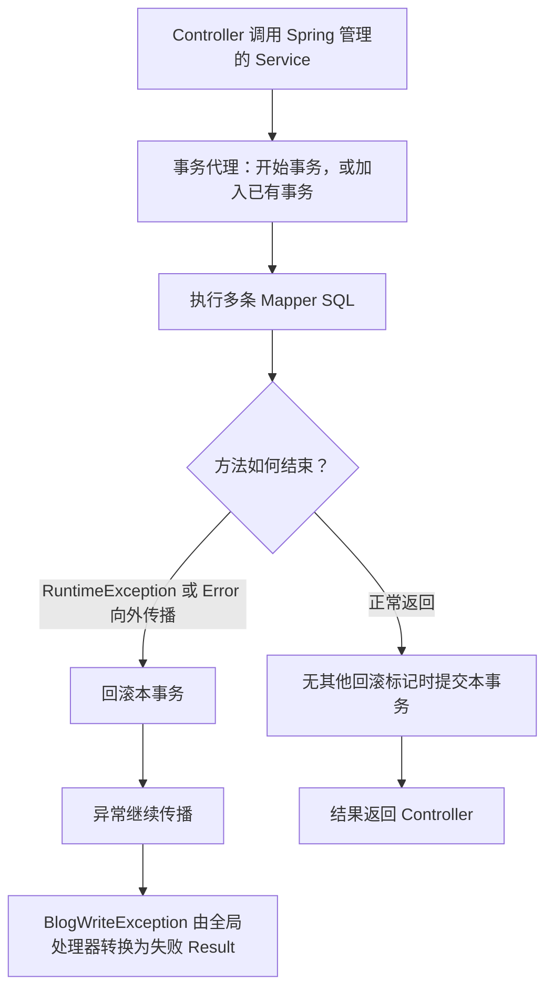
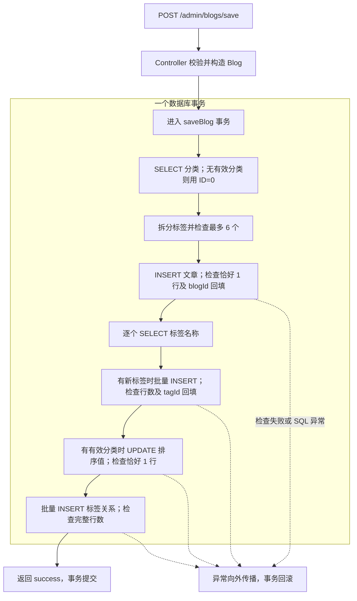
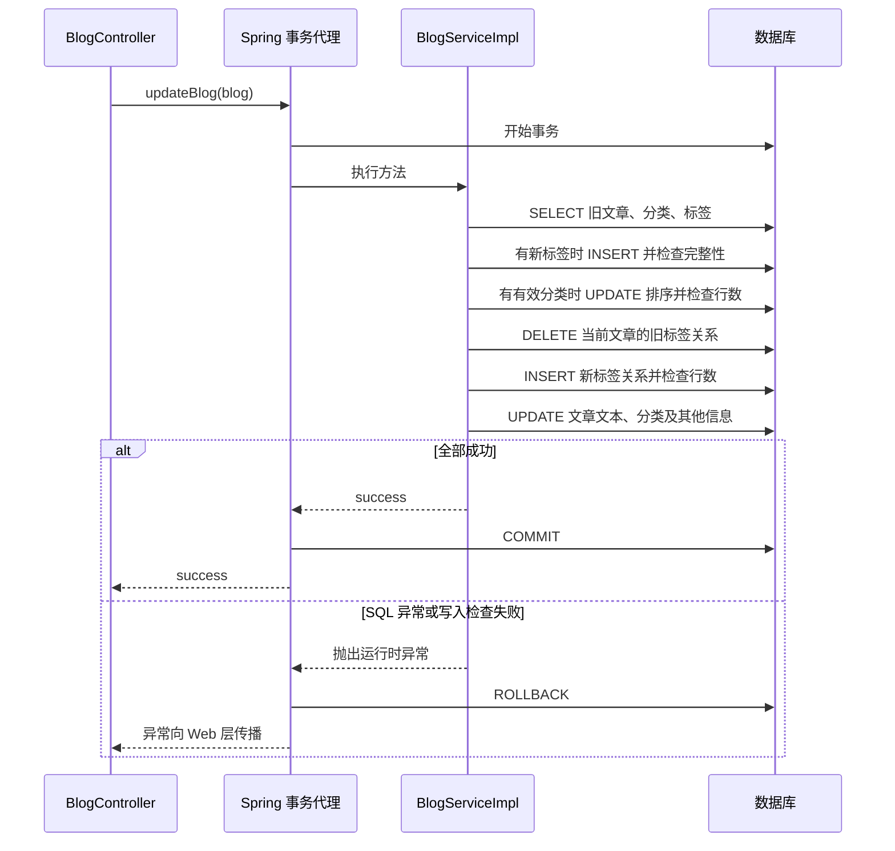
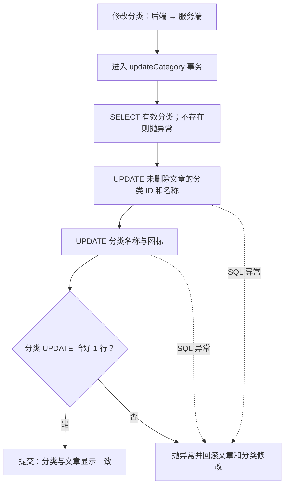
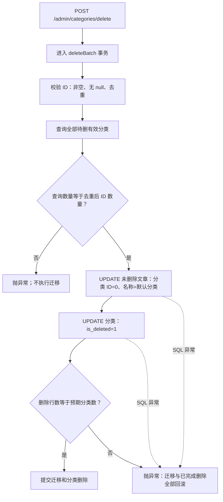
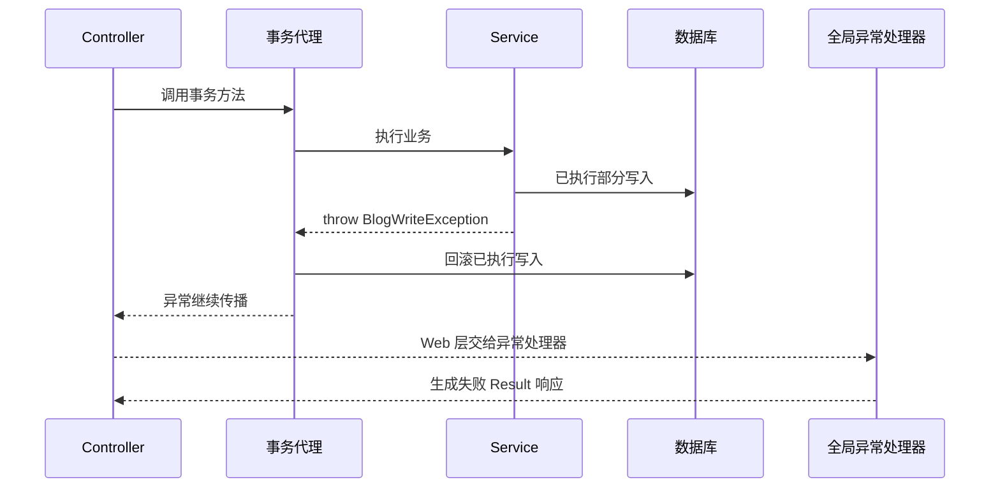
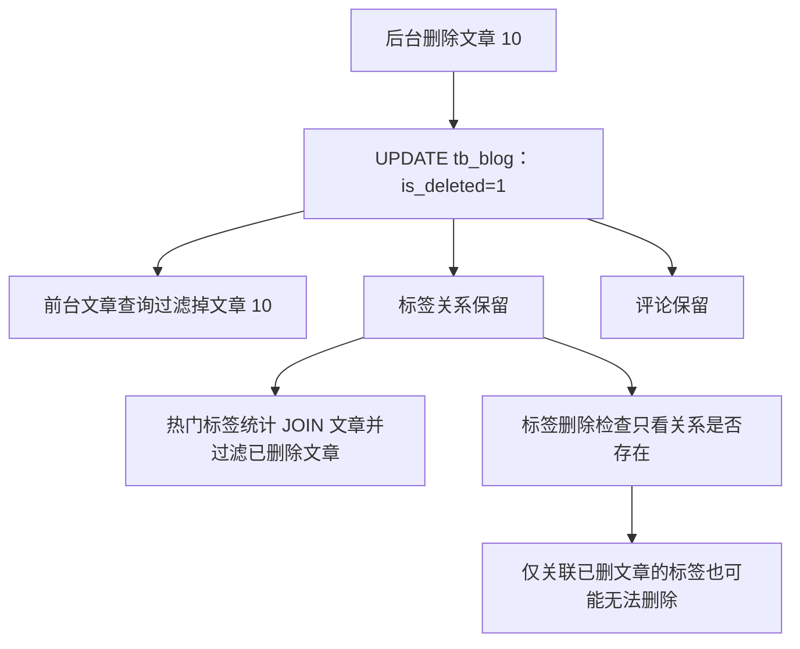
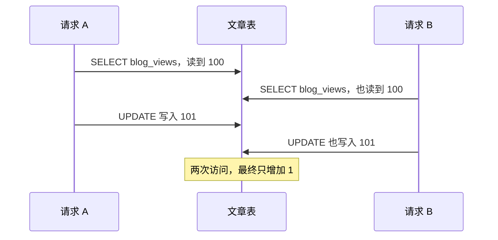

# 当前项目的多表关系与事务图解

分析日期：2026-10-11。依据：本次读取的工作区源码、MyBatis XML 和 `static-files/my_blog_db.sql`。本次未连接运行中的 MySQL，也未运行测试；数据库约束以仓库脚本为准，事务验证部分区分“源码行为”和“已有测试覆盖”。

> 当前版本已通过 `BlogWriteException` 和受影响行数检查加强文章、分类写入的回滚。本文按本次源码描述，不沿用早期版本“写入失败只返回字符串”的结论。

## 1. 先看多表关系：文章是中心

当前建表脚本定义了 8 张业务表，其中 5 张围绕文章形成关联，另外 3 张保存管理员、网站配置和友情链接。

| 关系 | 关联字段 | 含义 | 谁负责维护 |
|---|---|---|---|
| 分类 → 文章：一对多 | tb_blog.blog_category_id → category_id | 文章只有一个分类，一个分类可有多篇文章 | BlogServiceImpl、CategoryServiceImpl |
| 文章 → 评论：一对多 | tb_blog_comment.blog_id → blog_id | 一篇文章可有多条评论 | CommentServiceImpl；当前新增分支不检查文章有效性 |
| 文章 ↔ 标签：多对多 | 关系表中的 blog_id、tag_id | 一篇文章可有多个标签，一个标签可关联多篇文章 | BlogServiceImpl 创建或重建关系；TagServiceImpl 检查能否删标签 |

“一对多、多对多”描述业务模型，不表示数据库已经强制约束。脚本中的表使用 InnoDB，但没有 FOREIGN KEY，也没有 `(blog_id, tag_id)` 唯一约束。关联完整性主要由应用代码维护。

管理员表没有通过作者字段关联文章；登录身份用于后台访问控制，不构成文章作者的一对多数据关系。评论回复存储在评论原行的 `reply_body`，没有独立回复表或 parent_id，因此不是树形回复模型。

### 1.1 带字段的 ER 图

图中的虚线表示逻辑关系，未把关联字段标成数据库外键。分类 ID=0 是代码的“默认分类”约定：文章可以没有实际分类行，因此图中分类一侧允许零个关联对象。没有外键时，数据库也允许出现引用不存在文章或标签的关联记录。

### 1.2 用一组数据理解多对多

以下是教学示例，并非读取的实际数据库记录：

| 表 | 示例内容 |
|---|---|
| tb_blog_category | category_id=3，category_name=后端 |
| tb_blog | blog_id=10，blog_category_id=3，blog_category_name=后端，blog_tags=Java,SQL |
| tb_blog_tag | tag_id=5 / Java；tag_id=8 / SQL |
| tb_blog_tag_relation | (blog_id=10, tag_id=5)；(blog_id=10, tag_id=8) |
| tb_blog_comment | comment_id=100，blog_id=10 |

关系表每行只描述“某文章使用某标签”。另外一篇文章也可引用标签 5，无需复制 Java 标签。

文章表还保存两种冗余信息：

- `blog_category_name`：用于展示和分类名搜索，分类改名时需要同步。
- `blog_tags`：逗号分隔文本，详情页直接拆分展示；标签页按关系表查询文章。

同一份业务信息同时存在于文本和关联表中，保存、编辑时就需要让它们共同成功或共同撤销，这正是事务的用途。

## 2. 事务解决什么问题

保存文章不是一条 INSERT，而是一组写操作：文章、可能新增的标签、分类排序、文章标签关系。如果文章成功插入而关系失败，前台可能在首页看见文章，却在标签页找不到它。

事务把这些数据库写入作为一个整体：全部成功才提交；中途发生符合回滚规则的异常时，撤销本事务已经执行的写入。

当前 Controller 通过注入的 Service 接口调用公共方法，符合事务代理的常见调用方式。这里假设正常的 Spring/MyBatis 集成：相关 Mapper 使用同一数据源并参与同一个事务。

`@Transactional` 未显式设置传播、隔离、超时或 rollbackFor。其默认传播为 REQUIRED：没有事务时创建，有事务时加入；隔离采用底层默认设置，本文不据此断言运行数据库的实际隔离级别。默认对运行时异常和 Error 回滚，普通受检异常需要另行配置回滚规则。

如果加入已有事务，Service 正常返回并不表示数据库此时已经提交，最终由外层事务决定提交或回滚。当前展示的 Controller 调用路径没有另外声明外层事务。

### 2.1 项目中实际的事务边界

| Service 方法 | Controller 入口 | 涉及的写入表 | 显式事务 |
|---|---|---|---|
| BlogServiceImpl.saveBlog | POST /admin/blogs/save | 文章、可能新增的标签、分类、关系表 | 有 |
| BlogServiceImpl.updateBlog | POST /admin/blogs/update | 文章、可能新增的标签、分类、关系表 | 有 |
| CategoryServiceImpl.updateCategory | POST /admin/categories/update | 文章、分类 | 有 |
| CategoryServiceImpl.deleteBatch | POST /admin/categories/delete | 文章、分类 | 有 |
| BlogServiceImpl.deleteBatch | POST /admin/blogs/delete | 仅文章删除标记 | 无 |
| TagServiceImpl.deleteBatch | POST /admin/tags/delete | 先查关系，再更新标签 | 无 |
| 评论新增、审核、删除 | 评论相关接口 | 评论表 | 无 |
| CommentServiceImpl.reply | POST /admin/comments/reply | 先查评论，再更新原行 | 无 |
| ConfigServiceImpl.updateConfig | 配置提交接口逐项调用 | 先查配置，再更新对应行 | 无 |
| getBlogDetail / getBlogDetailBySubUrl | 前台详情页 | 查询文章后写回阅读量 | 无 |

无显式事务不意味着单条 SQL 没有数据库原子性；它表示应用未把前后多条 SQL 包成同一业务事务。单条批量 UPDATE 本身可一次修改多行，业务又可能把“受影响行数 > 0”当成功，这也不等于每个请求 ID 都存在且被处理。

## 3. 保存文章：四张表怎样共同提交

源码： [BlogServiceImpl.saveBlog](D:/Program/My-Blog-master/src/main/java/com/site/blog/my/core/service/impl/BlogServiceImpl.java:43)。

重要细节：

1. 读取分类时，代码先在 Java 对象中把 category_rank 加 1，真正写分类发生在标签插入之后。
2. 文章 INSERT 使用主键回填，关系 INSERT 依赖回填的 blogId。
3. `saveNewTags()` 检查批量插入行数是否等于新标签数，同时检查每个 tagId 非空。
4. 标签关系插入行数必须等于预期关系数，否则抛 `BlogWriteException`。
5. 新增文章的标签超过 6 个时，当前方法仍返回提示字符串；这发生在任何写入之前，所以此处没有已完成数据库写入需要撤销。

例如关系写入失败时，回滚不仅撤销关系，也会撤销刚插入的文章、新标签和分类排序更新。原本已经存在的标签保留。

回滚撤销数据库修改，不负责复原 Java 对象中的回填 ID，也不保证自增编号连续。不要把出现编号间隔当成事务回滚失败。

## 4. 编辑文章：删除旧关系也能回滚

源码： [BlogServiceImpl.updateBlog](D:/Program/My-Blog-master/src/main/java/com/site/blog/my/core/service/impl/BlogServiceImpl.java:130)。

编辑采用“删除旧关系，再插入新关系”，并不逐条比较标签差异。以下是源码实际顺序：

假设文章 10 原标签为 Java，新标签为 SQL：

| 时点 | 文章的 blog_tags | 关系表中的文章 10 |
|---|---|---|
| 编辑前 | Java | 指向 Java |
| 事务内部删除旧关系后 | 尚未更新 | 暂时没有关系 |
| 全部成功并提交 | SQL | 指向 SQL |
| 后续失败并回滚 | 恢复为原来的 Java | 恢复指向 Java |

表格描述当前事务内部的中间状态和最终结果，不代表其他连接在其隔离级别下必定能观察到每个中间步骤。

**DELETE 不等于不可回滚。** 这里是 InnoDB 中事务内的 DML DELETE，失败时原关系可以恢复。它与表结构变更、TRUNCATE 等操作不能混为一谈。

旧关系 DELETE 影响 0 行可能只是该文章没有标签关系，源码明确允许；它抛出 SQL 异常时仍会触发回滚。反之，最终文章 UPDATE 影响行数不等于 1，就会抛出异常，撤销之前的关系重建。

## 5. 分类改名与删除：维护冗余字段

### 5.1 分类改名

文章表保存 category_name 的副本。若只修改分类表，分类导航显示新名字，文章卡片和搜索却可能仍使用旧名字。

没有文章使用此分类时，文章 UPDATE 的 0 行结果是正常情况；分类本身仍应更新 1 行。同步 SQL 只更新 `is_deleted=0` 的文章，已删除文章保留原分类信息。

### 5.2 删除分类

删分类不会删文章，而是先把相关未删除文章迁移到默认分类，再软删除分类。

实际代理在进入整个方法前就建立事务，图中的参数校验也处于事务方法内；无效参数校验失败会在写入前抛出异常。

源码在 [CategoryServiceImpl](D:/Program/My-Blog-master/src/main/java/com/site/blog/my/core/service/impl/CategoryServiceImpl.java:52)。删除 ID 去重后再比较数量，避免 `[3,3,4]` 被误认为应删除 3 个分类。

## 6. 异常为什么能变成 JSON，同时保留回滚

`BlogWriteException` 继承 RuntimeException，用于表达“没有抛 SQL 异常，但业务要求的数据库写入没有完整成功”。例如批量关系预期 2 行，Mapper 只返回 1 行。

处理器在 Web 层捕获异常，此时异常已经离开事务方法，事务代理有机会回滚。因此“异常最终被处理”不等于“事务失效”。

如果反过来在事务方法内部 catch 异常，然后正常返回且没有设置 rollback-only，就可能提交先前写入。当前上述文章、分类方法没有这样吞掉异常。

当前全局处理器专门处理 BlogWriteException；不要据此断言所有底层 SQL 异常都会得到相同 JSON。运行时 SQL 异常可以触发回滚，响应格式仍由其他 Web 错误处理路径决定。

源码：[异常类](D:/Program/My-Blog-master/src/main/java/com/site/blog/my/core/Exception/BlogWriteException.java:4)、[异常处理器](D:/Program/My-Blog-master/src/main/java/com/site/blog/my/core/GlobalExceptionHandler/BlogWriteExceptionHandler.java:9)。

## 7. 事务覆盖之外仍有哪些一致性问题

### 7.1 删除文章会保留关系和评论

保留关系是当前实现行为，不代表数据库级级联删除。分类删除则会修改文章归属，两种删除行为不同。

### 7.2 标签删除的检查与写入没有统一事务

TagServiceImpl 先查关系，有关联就返回 false；无关联才软删除标签。两个步骤间若另一个请求新建关系，可能出现“新增关系引用已经删除的标签”。当前脚本没有外键替应用阻止这种情况。

仅加一个事务也不一定解决“先查后写”的并发问题；还需要结合隔离、锁和约束设计。标签与分类名称的“先查是否存在，再 INSERT”同样缺少名称唯一约束，事务原子性不能自动去重。

### 7.3 阅读量：事务原子性与并发安全是两件事

详情 Service 当前没有显式事务，使用 Java 的“旧值 +1”后通过 `updateByPrimaryKey` 写回，还会写其他基础字段。与后台编辑交错时存在覆盖旧值的风险。即使简单加上事务，也不能据此保证没有丢失更新。

改进方向是让数据库执行仅更新阅读量的原子语句，例如 `SET blog_views=blog_views+1`。这里仅分析，不修改业务实现。分类排序值也使用读出后加 1 的方式，且每次编辑都会增加，因此既可能并发漏加，也不是实时文章数量。

### 7.4 配置保存：同一张表也可能需要事务

ConfigurationController 一次提交逐项调用 `updateConfig()`，每项内部先 SELECT 再 UPDATE，没有覆盖整组配置的事务。例如名称已成功修改、后续图标更新异常，前面的更新不自动跟着撤销。

“多表操作才需要事务”并不准确：同表多行、同一业务操作的多条 SQL，也可能需要一起提交。应由业务一致性要求决定边界。

### 7.5 评论归属没有写入校验

新增评论直接 INSERT，没有在该调用链确认文章存在、已发布、未删除、允许评论。即使给 INSERT 加事务，也不会自动获得这些业务检查。回复采用先查询审核状态再 UPDATE 的方式，前后没有统一事务或版本检查，并发审核、删除时也需要明确规则。

## 8. 已有测试能证明到哪一步

仓库已经有事务测试，使用独立 H2 数据库、真实 Spring 事务代理和 MyBatis SQL，并通过 Mapper spy 或数据库约束制造失败。测试方法自身不加事务，因此能观察 Service 返回或抛异常后的数据库结果。

| 测试文件 | 源码中覆盖的场景 |
|---|---|
| BlogTransactionTests | 文章、新标签、分类、关系写入失败；关系部分成功；主键未回填；SQL 异常；编辑失败恢复旧文章和旧关系；成功提交 |
| CategoryTransactionTests | 分类更新或删除 0 行/部分成功；真实 SQL 约束失败；回滚文章分类迁移；成功提交；无文章分类；重复和无效 ID；回滚后失败响应 |
| BlogWriteResponseTests | BlogWriteException 对应的后台文章失败 JSON 契约 |

本次阅读了这些测试，没有执行，所以不能声称本次测试通过。H2 中的验证也不等于 MySQL 的并发、锁行为、批量主键回填和部署配置已经验证。

## 9. 建议阅读顺序与源码入口

1. [建表脚本](D:/Program/My-Blog-master/static-files/my_blog_db.sql)：确认关系字段、InnoDB 和缺失的外键约束。
2. [BlogServiceImpl](D:/Program/My-Blog-master/src/main/java/com/site/blog/my/core/service/impl/BlogServiceImpl.java:43)：跟踪保存、编辑的写入顺序及行数检查。
3. [CategoryServiceImpl](D:/Program/My-Blog-master/src/main/java/com/site/blog/my/core/service/impl/CategoryServiceImpl.java:52)：理解同步冗余名称和删除时迁移文章。
4. [BlogTagRelationMapper](D:/Program/My-Blog-master/src/main/resources/mapper/BlogTagRelationMapper.xml:41)：理解事务内物理删除与批量关系插入。
5. [TagServiceImpl](D:/Program/My-Blog-master/src/main/java/com/site/blog/my/core/service/impl/TagServiceImpl.java:50)：理解标签删除的关联检查。
6. [BlogTransactionTests](D:/Program/My-Blog-master/src/test/java/com/site/blog/my/core/BlogTransactionTests.java:81) 与 [CategoryTransactionTests](D:/Program/My-Blog-master/src/test/java/com/site/blog/my/core/CategoryTransactionTests.java:56)：对照失败注入与数据库状态断言。

可以带着三个问题读源码：哪些表必须保持一致？哪些 SQL 必须共同成功？写入失败怎样穿过事务代理触发回滚？这三个问题分别对应关系图、业务流程图和异常时序图。
